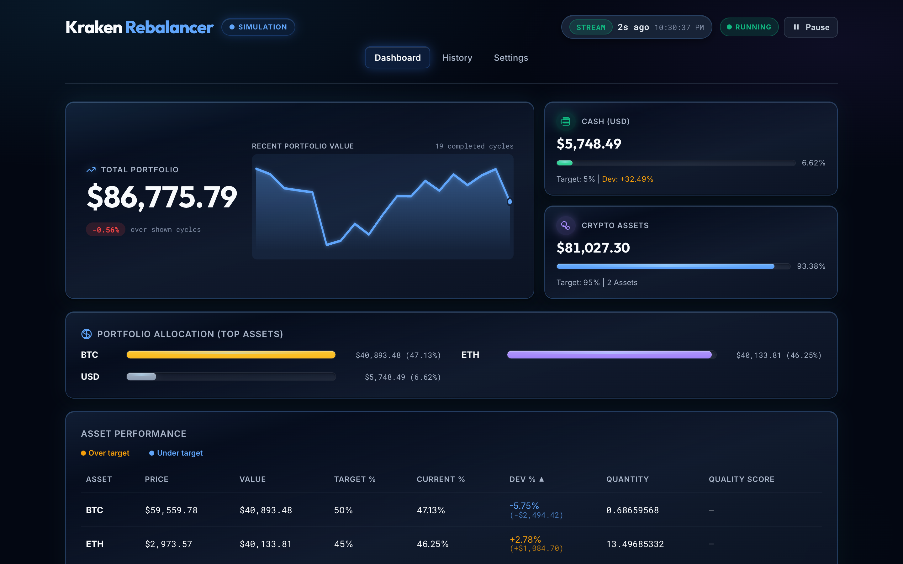
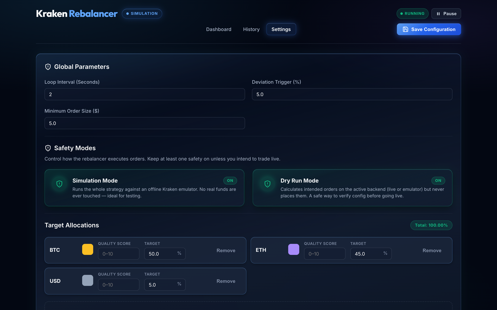
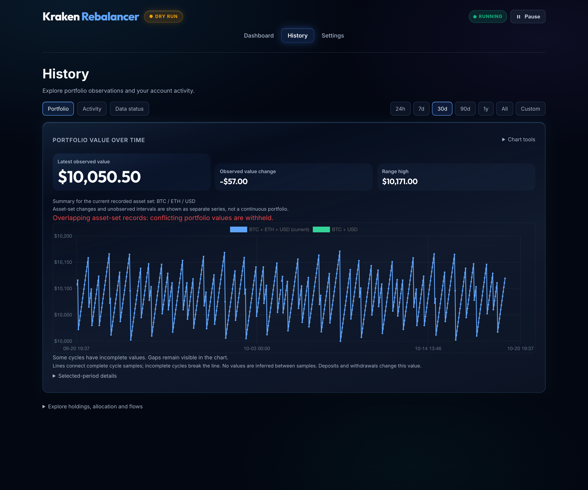
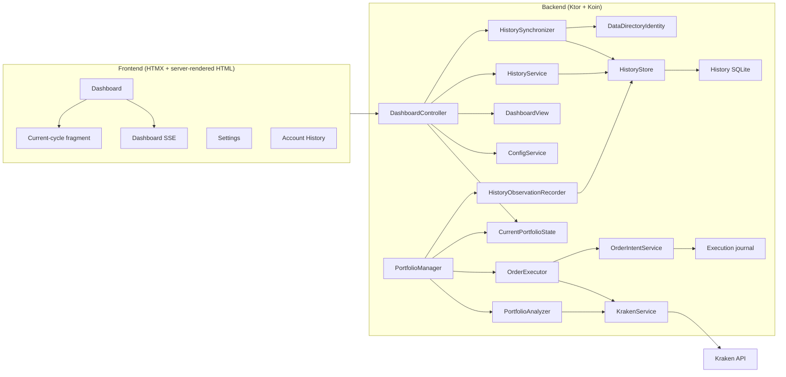

# Kraken Rebalancer

A production-grade, autonomous portfolio rebalancing engine for
the [Kraken](https://www.kraken.com/) cryptocurrency exchange. The system
continuously monitors your portfolio and automatically executes trades to
maintain configured target asset allocations, including a fixed target for
cash.

**This application has been running in production managing a live portfolio for
several months.**

**New here?** Start with the [User Guide](docs/USER_GUIDE.md) — a walkthrough
of Dashboard, History, Settings, and safety modes
(simulation / dry run).

---

## Why Use Kraken Rebalancer?

- **Stay disciplined automatically** — define the mix you want and let the bot
  correct meaningful drift instead of reacting to headlines or price swings.
- **Set a USD percentage target** — the configured weight remains fixed while
  its dollar value grows or shrinks with the current portfolio total.
- **Respond to cash changes** — rebalance new cash after a deposit or sell
  overweight assets after a withdrawal, according to the configured targets.
- **See the current cycle clearly** — inspect the latest portfolio snapshot,
  current allocations, and the actions taken in that cycle.
- **Test before trusting it with funds** — learn with the offline simulator, then
  rehearse against live market data in dry-run mode before enabling real orders.

The project is best suited to a self-hosting Kraken user who already has a target
allocation and wants consistent execution, not trading signals. It does not
predict prices, choose the right allocation, guarantee better returns, or remove
the risks of cryptocurrency trading. Rebalancing can also incur fees and tax
consequences, so you remain responsible for the strategy and its operation.

---

## AI-Assisted Development

This project—including its application code, tests, documentation, and agent
playbook—was developed through human-directed AI coding sessions. Most of the
initial project and much of its earlier evolution were created with Google
Antigravity. Cursor, Codex, and OpenCode are also used in the workflow, while
portable repository guidance is also available to Claude Code, GitHub
Copilot, and other agents. Independent models are used for adversarial review,
while tests, coverage, simulation, browser QA, and human approval provide the
final safety boundaries.

See the [Agentic Development Guide](docs/AGENTIC_DEVELOPMENT.md) for the full
provenance, instruction architecture, cross-harness setup, skill catalog,
human–agent workflow, review loop, and maintenance guidance.

Cross-provider routing, when needed, is handled by the host's native launchers
and the same portable `.agents/` guidance. The repository is still fully usable
without KiloCode. Application code, tests,
Gradle tasks, documentation, Git workflows, and the portable `.agents/` skills
remain available to any capable development tool. KiloCode-only additions are
strictly optional and isolated to Kilo harness configuration.

### Cline MCP Quota Tool

If you use [Cline](https://github.com/cline/cline) for AI-assisted development,
the repo includes a local MCP server that exposes `quota_check` so you can
inspect remaining provider quota without leaving your session.

```bash
# Install the dependency once from the repo root
cd .cline/mcp/quota-server
npm install
```

Then add the server to Cline's global MCP settings
(`~/.cline/data/settings/cline_mcp_settings.json`):

```json
{
  "mcpServers": {
    "quota": {
      "command": "node",
      "args": ["/absolute/path/to/new-kraken-rebalancer/.cline/mcp/quota-server/index.js"]
    }
  }
}
```

Restart Cline after editing the settings file. The server depends on
`@slkiser/opencode-quota` being available in your environment; install it once
with `npm install -g @slkiser/opencode-quota` if needed.

---

## Tech Stack

| Layer           | Technology                                                                                                   |
| --------------- | ------------------------------------------------------------------------------------------------------------ |
| **Language**    | Kotlin 2.4.20 (Kotlin Multiplatform: JVM + JS)                                                               |
| **Backend**     | Ktor 3.5.2 (Netty engine), Koin 4.2.2 (DI), Jackson 2.22.3                                                   |
| **Database**    | SQLite (via JetBrains Exposed ORM 1.5.0)                                                                     |
| **HTTP Client** | Ktor CIO Client (async, coroutine-native)                                                                    |
| **Concurrency** | Kotlin Coroutines (`kotlinx.coroutines` 1.11.0)                                                              |
| **Frontend**    | Server-side HTML (kotlinx.html DSL + HTMX), kotlinx-css DSL, Ktor SSE + Kotlin/JS interactions for all pages |
| **API**         | Kraken REST API with HMAC-SHA512 authentication                                                              |
| **Testing**     | Kotest 6.2.5 + MockK 1.14.11; backend JaCoCo 95% lines/85% branches (temp), engine 95/90; Karma 90/80/75     |
| **Build**       | Gradle 9.8.0 (Kotlin DSL), Spotless 8.10.3 + ktlint 1.8.0                                                    |
| **Engine**      | Pure Kotlin JVM domain calculation library with independent JaCoCo 95/90 coverage gates                      |
| **Codegen**     | JVM-only module with KSP processors for API mappers and YAML string catalogs                                 |
| **Agent tools** | Optional Kilo Context Mode plugin for bounded large-output analysis; standard workflows remain portable      |

---

## Technology Journey

This project has served as both a real production tool and a personal learning
lab. The full history of each migration is preserved in the
[CHANGELOG](CHANGELOG.md), the git history, and in dedicated branches — every
rewrite is a checkpoint you can browse on GitHub.

### Phase 1 — Java / Spring Boot / Maven *(Jan – May 2026)*

The application was originally written in **Java 25** with **Spring Boot 4**,
**Maven**, **Lombok**, **OkHttp**, and **JUnit 5 / Mockito** — the stack I am
most experienced with and the one I use professionally. The frontend started as
a **React/Vite** SPA with vanilla JavaScript and Chart.js, and was later
migrated to **TypeScript** with **Tailwind CSS v4** and a full **Vitest** suite.
This phase produced the core rebalancing algorithm, Kraken API integration with
HMAC-SHA512 authentication, and a full CI pipeline on GitHub Actions. By the
time the project was made public (May 2026), the Java backend had 89+ unit tests
enforcing 95%+ coverage, the TypeScript frontend had 97 Vitest tests, and the
application included production-hardened features like atomic file writes,
structured order results, and graceful shutdown.

Development during this phase used feature branches merged via pull requests:

- `fix/security-and-ci-hardening` (PR #9) — security hardening and CI
  enforcement
- `refactor/backend-code-quality` (PR #10) — service/repository layering and
  import cleanup
- `feature/engine-hardening` (PR #12) — rebalancer engine reliability
  improvements
- `large_refactor` (PR #13) — TypeScript migration, Tailwind CSS v4 integration,
  Lombok adoption, and 95%+ coverage enforcement across both frontend and backend

> The early commit history showcases idiomatic Java, Spring Boot dependency
> injection, service/repository layering, JUnit 5 testing patterns, and Maven
> build configuration.

### Phase 2 — Kotlin / Ktor / Koin / Gradle *(May 2026)*

The entire codebase was migrated from Java to **Kotlin 2.x**, **Ktor** (Netty
engine), **Koin** (DI), **Gradle** (Kotlin DSL), and **Kotest / MockK** for
testing. This migration was developed on the `kotlin-migration` branch and
merged via PR #15. Kotlin's coroutines replaced Java's
`ScheduledExecutorService` and `Thread.sleep`, making the rebalancing loop and
all API calls fully non-blocking.

The Kotlin phase continued with several focused branches:

- `cursor/rebalancer-reliability-and-safety-fixes` (PR #16) — `BigDecimal`
  order precision, `AtomicJsonFile` utility, `OrderResult` model, and 122
  backend + 110 frontend unit tests
- `htmx-html-dsl` (PR #17) — replaced the React/Vite frontend with
  **server-side HTML** using the **kotlinx.html** DSL and **HTMX**. Before
  landing on HTMX, I also explored **Angular** as a potential frontend
  framework, but the overhead of a full Angular project with its own build
  pipeline and module system felt disproportionate for a single-page dashboard
  — that exploration was done locally and never committed. HTMX turned out to
  be the ideal fit: it eliminated the separate frontend build pipeline entirely,
  added **Ktor SSE** for real-time dashboard updates, and achieved 100% test
  coverage across every metric
- `code_quality` (PR #18) — centralized CSS classes, HTML IDs, inline styles
  extraction, service layer SRP decomposition (`PortfolioAnalyzer` +
  `OrderExecutor`), and test symbol constants
- `refactor/kotlin-modernization` (PR #19) — Kotlin 2.4.10 named context
  parameters, `Asset` inline value class, pipeline typealiases, and Gradle
  configuration caching

### Phase 3 — Go *(Jun 2026, experimental)*

The application was rewritten in **Go 1.26** — goroutines, `net/http`,
`html/template`, `encoding/json`, `log/slog`, and `shopspring/decimal`. The Go
version achieved 98.2% test coverage with strict per-package gates. The complete
Go codebase is preserved on the [`go-rewrite`](../../tree/go-rewrite) branch
(10 commits).

### Phase 4 — TypeScript / Node.js / NestJS *(Jun 2026, experimental)*

The application was then rewritten in **TypeScript** with **Node.js**, starting
with a plain Express backend and React/Vite frontend, then migrating to
**NestJS** with **Tailwind CSS v4**, using Zod schema validation, the NestJS
module/controller/service pattern, and native `fetch` in Node.js. The complete
TypeScript/NestJS codebase is preserved on the
[`feature/typescript-rewrite`](../../tree/feature/typescript-rewrite) branch
(8 commits).

### Phase 5 — 100% Kotlin & Kotlin Multiplatform *(Jun 2026 – present)*

After building the same application three different ways, **Kotlin / Ktor**
became the permanent stack. To eliminate client-side JavaScript entirely, all
remaining frontend scripts were migrated to **Kotlin/JS** using **Kotlin
Multiplatform (KMP)**. The codebase is now **100% Kotlin**, offering the best balance of:

- **Kotlin Multiplatform** — compiling a `:frontend-js` subproject directly to JavaScript via the Kotlin JS IR backend, replacing legacy browser scripts with type-safe Kotlin code.
- **Conciseness** — data classes, extension functions, and coroutines dramatically reduce boilerplate compared to Java.
- **Type safety** — `kotlinx.html` gives compile-time-checked HTML rendering that Go's `html/template` and JSX cannot match, while Kotlin/JS handles all client-side actions and table sorting with strong compile-time types.
- **JVM ecosystem** — access to battle-tested libraries (Jackson, Netty, JaCoCo) without the weight of Spring Boot's classpath scanning.
- **Single-process simplicity** — HTMX and Kotlin/JS compile to a single bundled asset served dynamically, keeping the entire application within a single `./gradlew run` command.

The experimental branches (`go-rewrite` and `feature/typescript-rewrite`) remain in the repository as complete, working
reference implementations for anyone interested in comparing the same domain
logic across three languages and ecosystems.

Earlier Phase 5 updates integrated a reactive configuration loop (`watchConfigChanges().collectLatest`), a Kraken call-counter rate limiter, flow-based API retry policies, and paginated trade-history reporting. The History page now reuses those imported account ledgers to derive historical daily balances and USD values while retaining the separate direct cycle observations. Order-specific fill confirmation continues to use Kraken trade history for sell settlement. The remaining client-side JavaScript logic was rewritten to Kotlin/JS under the `:frontend-js` subproject, achieving a 100% Kotlin codebase.

### Technologies Explored

| Category               | Technologies Used                                                                                                                     |
| ---------------------- | ------------------------------------------------------------------------------------------------------------------------------------- |
| **Languages**          | Kotlin 2.4 (current), Kotlin 2.x, Java 25, Go 1.26, TypeScript (all phases documented in CHANGELOG)                                   |
| **Backend Frameworks** | Ktor 3.5.2 (current), Spring Boot 4, Ktor 2.3, NestJS, Express, Go `net/http`                                                         |
| **DI / IoC**           | Koin 4.2.2 (current), Spring IoC (`@Autowired`), Koin 3.5, NestJS modules                                                             |
| **Build Systems**      | Gradle 9.8.0 Kotlin DSL (current), Maven, npm / yarn, Go modules                                                                      |
| **Frontend**           | Kotlin/JS + kotlinx.html + HTMX (current), React, Angular (explored), Tailwind CSS v4, Chart.js                                       |
| **HTTP Clients**       | Ktor CIO Client (current), OkHttp, Node.js native `fetch`, Go `net/http`                                                              |
| **Concurrency**        | Kotlin Coroutines (current), Java `ScheduledExecutorService`, Go goroutines, Node.js event loop                                       |
| **Testing**            | Kotest 6 + MockK + Karma/Istanbul (current), JUnit 5, Mockito, Vitest, Go `testing`                                                   |
| **Coverage**           | Backend JaCoCo 95% line/method/instruction + 85% branch temporarily; engine 95%/90%; Karma/Istanbul 90/80/90/75 (current)             |
| **Serialization**      | Jackson 2.22.3, Go `encoding/json`, Zod schema validation                                                                             |
| **Real-Time**          | Ktor Server-Sent Events (SSE), Kotlin `SharedFlow` (config changes) and `StateFlow` (latest cycle snapshot), HTMX SSE extension       |
| **CI / Security**      | GitHub Actions, Dependabot, SHA-pinned actions, CVE patching (Netty, Logback, Jackson); CodeQL Java/Kotlin analysis enabled on `main` |
| **Code Quality**       | Lombok, ESLint, `go fmt`, Kotlin named context parameters, strict `BigDecimal` precision, atomic file I/O                             |

---

## Features

### Autonomous Rebalancing

- Continuously monitors portfolio allocations against configurable targets
- Automatically generates and executes market orders when absolute deviation
  thresholds (`>=`) are met
- Sells overweight assets first to generate liquidity, then buys underweight
  assets

### Proportional USD Target

- Keeps the configured USD percentage as the target weight during each rebalance
- Recalculates its dollar amount from the current portfolio total each cycle
- Bases orders on current account balances, market prices, configured weights,
  and the deviation threshold

### Intelligent Fiat Correction

- Recognizes when only USD triggers a deviation threshold (e.g., after a deposit
  or withdrawal)
- Distributes surplus cash proportionally among the most underweight assets
- Handles withdrawals by selling from the most overweight assets

### Live Dashboard

- Shows the latest completed cycle and a trailing chart of up to 24 recent
  in-memory cycles; the chart appears after the second cycle and resets when the
  application restarts, so it never imports unverified database history
- Pushes current-cycle updates over Server-Sent Events
- Horizontal bar chart showing asset allocation by value
- Sortable holdings table with price, value, target/current allocation, deviation,
  quantity, and quality score; asset links open filtered History
- **Recent Activity** — current-cycle action feed with BUY/SELL badges
- **Recent Activity history** — newest 20 cycle outcomes with older-page
  navigation, including failed cycles; the in-memory history is capped at 120.
- STREAM/STALE SSE stream-health indicator with relative age/time (separate from trading mode)
- Persistent mode plate (SIMULATION / DRY RUN / LIVE TRADING)
- **Hypermedia-powered** — uses HTMX for HTML swaps and form submissions, plus
  Kotlin/JS (`rebalancer.js`) for browser interactions

### Account History and Portfolio Value

- `/history` has Account value, Trades, Transactions, and Data status views.
  Account value reuses imported exchange records to derive daily historical
  balances and USD totals for a 365-day target; direct cycle observations remain
  separate. Trades and transactions are independently filtered, paginated, and
  exportable.
- After account identity is verified, a background coordinator refreshes the
  recent trade and ledger windows, resumes a durable older backfill, repairs the
  last seven days daily, and requests a refresh five seconds after a qualifying
  live order submission.
  A manual Retry remains available for blocked synchronization. Simulation
  never imports Kraken trades or ledgers.
- Exchange records remain scoped to the verified account; changes in configured
  assets create separate value series. Asset, pair, and event-type filters apply
  to exchange records, not bot-activity exports. Because Kraken records do not
  prove which bot cycle caused a fill or its lifecycle, linkage is shown as
  `Unknown` rather than inferred.
- Account History reuses imported Kraken ledgers to derive daily balances and
  USD values for the latest year. Completed Kraken daily candles price holdings;
  missing balance or price evidence stays visible as a dated gap. Equity-class
  share balances are excluded; all USD ledger changes, including stock-trade
  settlement and dividend credits, remain cash. These are historical closing-price estimates,
  not profit or investment-return calculations.
- Daily charts, holdings, status, and CSV exports read values and their per-asset
  details from one bounded SQLite snapshot, so a valuation publication cannot
  mix generations. If Kraken explicitly rejects a direct market as unknown, the
  resolver tries same-day BTC or EUR conversion evidence; network and rate-limit
  errors retain their retry behavior. USD is always valued at exactly one.
- Before rebalancing a configured non-USD asset, Kraken metadata must classify it
  as `currency`. Missing, tokenized, or unknown classes stop the cycle before
  price analysis; the system does not guess from ticker names. This protects the
  order path without changing the historical ledger-based equity exclusion.
- History statistics show the latest available account value and its change
  over the selected period, with deposits and withdrawals called out. Trade
  volume and fees stay grouped by currency; funding and rewards stay in native
  asset units.
- Account-value ranges default to 30 days and offer 24h, 7d, 30d, 90d, 1y, All,
  and custom dates. Marks use completed UTC daily candles. The 24h range uses
  available daily marks because a full-account intraday capture is not available.
- Save named views in your browser to recall favorite filters. Interactive
  charts support value/time tooltips, line/point views, zoom, earlier/later
  navigation, reset, and expansion.
  Account-value charts retain daily gaps and export missing-data reasons. Legacy
  direct observations remain available as technical recorded history. See the
  [History section in the User Guide](docs/USER_GUIDE.md#history) for sources,
  scope, and limitations.

### Hot-Reload Configuration

- Modify all settings (allocations, thresholds, assets) via the web UI
- Add or remove assets without restarting the application
- Allocation validation ensures targets always sum to 100%
- `ConfigService.watchConfigChanges()` exposes a `Flow<Settings>`, which
  `PortfolioManagerImpl` uses to restart its sleeping rebalancing loop with new
  settings without polling. Saves made during an active cycle persist
  immediately but defer runtime publication until that execution session ends.

### Offline Exchange Simulator

Run in Simulation Mode without Kraken keys to rehearse cycles against the offline
exchange emulator. Simulation provides current-cycle Dashboard data and a
separate, process-scoped History value series; it does not authenticate an
account or sync Kraken trades and ledgers. Simulated values are not account
history.

### Safety & Reliability

- **Dry Run Mode** — calculates intended orders on the active backend (live
  Kraken or the emulator) but never places them
- **Structured Order Results** — each order returns success/failure status;
  failed orders don't corrupt cash projections
- **Durable Live-Order Journal** — before a real AddOrder request, the bot
  persists a `PENDING` intent with its deterministic `cl_ord_id`. Ambiguous
  transport/response failures become `UNCERTAIN`, abort the remaining batch,
  and block later live orders until an operator verifies Kraken and resolves
  the SQLite row with `POST /api/order-intents/{id}/resolve` using explicit
  evidence and the optional Kraken `orderTxid` when known. `PENDING` rows cannot
  be manually resolved while an AddOrder may
  still be in flight; abandoned PENDING rows are recovered as UNCERTAIN on
  restart. Unresolved intents are not reconciled, deduplicated, or pruned
  automatically. Follow the [operator recovery runbook](SECURITY.md#operator-recovery-runbook)
  before resolving an intent
- **Atomic File Writes** — config updates use write-then-atomic-rename (NIO Files.move with StandardCopyOption.ATOMIC_MOVE) to prevent file system corruption
- **Graceful Shutdown** — JVM shutdown hook cleanly cancels the coroutine loop scope, closes Ktor HttpClient, and stops Koin DI
- **Redacted Secret Logging** — value class `toString()` implementations for API credentials return redacts to protect application logs
- **Rate-Limiting & Retries** — Private calls use Kraken's standard linearly
  decaying account counter; `AddOrder` and `CancelOrder` use Kraken's separate
  trading limits.
  Public calls use a separate conservative limiter of at most about one call
  per second. `retryWithFlow` retries only network I/O, 429, temporary lockout,
  and relevant 5xx responses with capped backoff; AddOrder is attempted once
  because an ambiguous response may follow an accepted order. See Kraken's
  [current rate-limit guidance](https://support.kraken.com/articles/206548367-what-are-the-api-rate-limits-?mobile_site=false)
- **CORS Restrictions** — by default, limits browser origins to local machine addresses (`localhost`, `127.0.0.1`), Bonjour multicast DNS domains (`*.local`), and private local subnets (`192.168.x.x`, `10.x.x.x`, `172.16–31.x.x`, link-local `169.254.x.x`). `REBALANCER_ALLOWED_ORIGINS` can add exact origins; `REBALANCER_ALLOW_ALL_ORIGINS=true` is a lab-only break-glass override that disables origin checks and must never be used with live keys. CORS is not authentication.
- **No dashboard user auth** — trust model is local/private network; see [SECURITY.md](SECURITY.md)
- **Explicit Data Store Initialization** — the execution journal and History
  store use separate validated SQLite files; initialize them once before
  startup, and normal startup refuses to recreate a missing file-backed store
- **Operational Readiness** — `/api/health` is a liveness/diagnostic endpoint;
  `/api/readiness` reports whether the loop, latest cycle snapshot, and live-order
  journal are safe for continued operation
- Dust threshold filtering to avoid minimum order size errors
- Automatic error recovery — API failures don't crash the rebalancing loop
- Price validation — aborts cycle if any asset price is unavailable
- **BigDecimal Precision** — all balances, prices, and volumes are tracked via `BigDecimal` to completely eliminate floating-point precision loss

---

## Screenshots

The current UI centers on the latest Dashboard cycle, account History, and
active Settings.

<a href="docs/images/dashboard.png"></a>

<a href="docs/images/settings.png"></a>

<a href="docs/images/history.png"></a>

---

## Architecture



### Rebalance Cycle

Each cycle reads current balances and prices, compares the portfolio with the
configured targets, executes eligible orders, and publishes the completed
cycle snapshot for the Dashboard. Live-order intent and outcome handling remain
part of the separate execution-safety path.

See **[ALGORITHM.md](docs/ALGORITHM.md)** for current fixed-target rebalance
logic, order sequence, and safety behavior. See **[FLOWS.md](docs/FLOWS.md)**
for the active configuration, Dashboard SSE, order-settlement, and History
capture/synchronization flows.

### Dashboard updates

The `/api/status/stream` SSE endpoint sends completed cycle snapshots to the
Dashboard shell. HTMX requests `/fragments/dashboard` when an update arrives.
The latest snapshot is displayed as current-cycle state; it is not a retained
retrospective timeline. The STREAM/STALE chip describes update freshness and is
separate from the SIMULATION / DRY RUN / LIVE TRADING mode plate.

Settings changes update the configuration used by later cycles. During an
active cycle, the saved settings take effect after that cycle finishes so one
cycle does not mix configuration values.

---

## Project Structure

```text
├── .agents/                    # Repository agent rules and skills
├── common/                     # Shared KMP configuration, models, and UI catalogs
├── engine/                     # Pure portfolio valuation, allocation, and order-planning math
├── frontend-js/                # Kotlin/JS interactions for Dashboard, Settings, and History
├── backend/                    # Ktor server, rebalance loop, execution, and views
│   └── src/main/kotlin/com/gemini/krakenbot/
│       ├── config/             # DI, data directory, fresh databases, and startup wiring
│       ├── controller/         # Dashboard, Settings, History, health, and SSE routes
│       ├── service/            # Current portfolio state and application services
│       │   ├── history/        # Account-scoped sync, activity, and SQLite persistence
│       │   ├── reporting/      # Range-aware statistics and native-asset series
│       │   └── impl/           # Configuration, analysis, execution, and loop services
│       └── view/               # Dashboard, Settings, History HTML and CSS
├── docs/                       # User, architecture, security, and evaluation guides
├── rebalancer-config-template.json
└── build.gradle.kts            # Root Gradle aggregator
```

---

## Getting Started

### Prerequisites

- JDK 25 or higher
- Gradle (or use the included `./gradlew` wrapper — no installation required)
- For **dry-run-against-Kraken**: an API key with **Query Funds**. For **live
  trading**, also grant **Query Closed Orders & Trades** and **Create & Modify
  Orders**.
- For **`simulation: true`**: no real keys required — template placeholders are
  enough; the emulator never calls Kraken

### 1. Clone & Configure

```bash
git clone https://github.com/HyperVon/new-kraken-rebalancer.git
cd new-kraken-rebalancer
cp rebalancer-config-template.json rebalancer-config.json
```

> [!WARNING]
> `rebalancer-config.json` is **gitignored** and must **never** be committed. It
> holds your Kraken API key and private key — keep credentials local only.
> POSIX systems use owner-only file permissions; ACL-capable Windows and other
> non-POSIX filesystems use a current-owner ACL, while unsupported filesystems
> refuse to persist credentials.

Edit `rebalancer-config.json`:

- Add your Kraken API Key and Private Key
- Define your desired `allocations` (must sum to 100%, must include USD)
- Set `dryRun` to `true` for initial testing
- `allocations.USD` sets the configured cash percentage; its target dollar amount
  scales with the current portfolio total

Older configuration files and the shipped template may still contain retired
history-only keys such as `fiatMaxDrawdown`, `fiatDeploymentExponent`,
`fiatDeploymentThresholdPercent`, `inceptionDate`, or `comparisonStartDate`.
They are discarded when the configuration is read and have no effect on
orders. The next Settings save writes the active configuration without those
retired keys.

The execution and History databases are created automatically the first time
the application starts in a fresh data directory. This creates `execution.db`,
`execution.db.journal-id`, and `history.db` under `rebalancer-data-v1` by
default. Set `KRAKEN_DATA_DIR` or pass `-Dkraken.data.dir=<path>` to select
another directory for both initialization and normal startup. A directory
holding only one of the two databases is treated as half-copied or tampered and
fails closed — restore the matching file or start from a fresh directory. The
`--initialize-data` flag remains available for explicit initialization and
refuses to replace an existing execution or History database. Database files at
older locations are left untouched and are not imported or migrated. To reopen
existing data, configure the directory that contains the active `execution.db`
and `history.db` files.

### 2. Start the Application

You can start the application using the convenient pre-configured startup scripts (which automatically compile the Fat JAR if it has not yet been built):

- **macOS / Linux**:

  ```bash
  ./start.sh
  ```

- **Windows**:

  ```cmd
  start.bat
  ```

#### Alternative Startup Methods

If you prefer to run using Gradle directly:

```bash
./gradlew run
```

Or if you wish to build and execute the Fat JAR manually:

```bash
# Build the Fat JAR containing all dependencies
./gradlew :backend:fatJar

# Run using the JVM (includes optimal JVM parameters for native SQLite memory access)
java -Xshare:off --sun-misc-unsafe-memory-access=allow --enable-native-access=ALL-UNNAMED -jar backend/build/libs/kraken-bot-0.0.1-SNAPSHOT-all.jar
```

For a local quality-gated release build, use `./gradlew build :backend:fatJar` without
`clean` so Gradle can reuse compilation, Kotlin/JS, Webpack, and test outputs.
Reserve `clean` for troubleshooting stale outputs. Gradle runs independent
projects in parallel and uses up to two JVM test forks by default; override on
smaller machines with `-PtestForks=1` or `-PtestMaxHeap=1g`.

The backend starts on port **8080** and begins the rebalancing loop immediately.
To bind a different port, pass the JVM property `-Dkraken.server.port=<port>`
(valid range `1`–`65535`) when starting the application.

### 3. Open Dashboard

Open your browser to **<http://localhost:8080>**. The dashboard is served directly
from the backend.

> [!NOTE]
> **Zero-Setup Kotlin/JS Build:** The client-side code is written in Kotlin and compiled to JavaScript (`rebalancer.js`) via the Gradle build pipeline. The build process automatically downloads and executes an isolated local copy of Node.js and Yarn inside the `.gradle/` directory. **You do not need to install Node, npm, or Yarn on your host machine.**

#### Frontend Development Tasks (Optional)

If you are modifying the client-side code in `frontend-js/` and want to compile or verify only the JS bundle:

```bash
# Compile and bundle the Kotlin/JS subproject via production Webpack
./gradlew :frontend-js:jsBrowserProductionWebpack

# Compile and copy the bundle directly into the Ktor JVM static resources folder
./gradlew :backend:copyJsBundle
```

---

## Configuration Reference

| Field                            | Type      | Default             | Description                                                                           |
|----------------------------------|-----------|---------------------|---------------------------------------------------------------------------------------|
| `loopDelaySeconds`               | `Long`    | — (template `60`)   | Seconds between rebalance cycles; required in JSON                                    |
| `deviationTriggerPercent`        | `Double`  | — (template `5.0`)  | Minimum absolute deviation % to trigger a trade; required in JSON                     |
| `minimumOrderSizeUSD`            | `Double`  | `5.0`               | Min significant USD deviation (order generation) and min order notional (execution)   |
| `dryRun`                         | `Boolean` | — (template `true`) | Required in JSON; suppresses order placement on the active backend (live or emulator) |
| `simulation`                     | `Boolean` | `false`             | If true, routes exchange calls to the offline emulator; no Kraken key is required     |

Account History and live-order intents use separate SQLite files in the active
data directory: `history.db` and `execution.db`. The directory defaults to
`rebalancer-data-v1`; set `KRAKEN_DATA_DIR` or `-Dkraken.data.dir` to choose a
different location. Fresh files are created automatically on the first normal
start. Normal startup opens existing, validated schemas and fails closed if
only one store is present or the execution journal identity marker is missing.
Keep the whole data directory together when backing up, including
`execution.db.journal-id` and `account-identity.sha256`. History and execution
stores do not import records from the former reporting or Actual databases.
See the [execution-journal storage notes](SECURITY.md#execution-journal-storage-and-recovery)
for account binding and recovery requirements.

Before a real live order, the execution journal must hold a verified Kraken
account binding. The first binding authenticates the account IIBAN; credential
rotations must authenticate to the same IIBAN. The journal stores only digests
and an audit trail, while the shared data-directory identity keeps account
History and execution state pinned to that account. A mismatch, missing or
corrupt binding, or prior live-order record without a binding blocks live
submission. Simulation and dry-run modes do not create a live account binding.

> **Note:** `minimumOrderSizeUSD` is enforced to a minimum of `2` in `ConfigService` and the Settings UI (`min="2"`).

---

## API Endpoints

| Method | Path | Description |
| --- | --- | --- |
| `GET` | `/` | Main dashboard shell (HTML) |
| `GET` | `/settings` | Settings page (HTML) |
| `POST` | `/settings` | Submit settings form (HTMX) |
| `GET` | `/history` | Account-scoped portfolio value, trade, ledger, and balance-checkpoint history |
| `GET` | `/api/history/trades` | Paginated exchange trade history (JSON) |
| `GET` | `/api/history/ledgers` | Paginated exchange ledger history (JSON) |
| `GET` | `/api/history/checkpoints` | Paginated ledger balance checkpoints (JSON) |
| `GET` | `/api/history/sync-status` | Current account-history synchronization status (JSON) |
| `GET` | `/api/history/charts` | Range- and scope-selected History chart series (JSON) |
| `GET` | `/api/history/holdings?date=YYYY-MM-DD` | Account holdings and availability for a daily UTC mark (JSON) |
| `GET` | `/api/history/summary` | Coverage and range-aware History statistics (JSON) |
| `GET` | `/api/history/scopes` | Available recorded portfolio scopes (JSON) |
| `GET` | `/api/history/activities` | Cursor-paginated bot-cycle activity (JSON) |
| `GET` | `/api/history/data-status` | Per-feed recent, backfill, repair, and failure state (JSON) |
| `GET` | `/api/history/export/trades` | CSV export of filtered trade records |
| `GET` | `/api/history/export/ledgers` | CSV export of filtered ledger records |
| `GET` | `/api/history/export/activity` | CSV export of scoped bot activity; event filters do not apply |
| `GET` | `/api/history/export/account-values` | CSV export of daily account totals and missing-data reasons |
| `GET` | `/api/history/export/account-holdings?date=YYYY-MM-DD` | CSV export of holdings for one UTC daily mark |
| `POST` | `/api/history/repair` | Queue a selected date/window repair (CSRF-protected) |
| `POST` | `/api/history/sync/start` | Request or resume bounded trade and ledger synchronization (CSRF-protected) |
| `GET` | `/fragments/dashboard` | Dashboard fragment (HTMX) |
| `GET` | `/api/status/stream` | Server-Sent Events (SSE) stream for real-time portfolio snapshot updates |
| `GET` | `/api/health` | Public health check endpoint returning app status and metrics (JSON) |
| `GET` | `/api/readiness` | Readiness status; returns `503` until safe to operate (JSON) |
| `GET` | `/api/order-intents` | Unresolved live-order intents for operator review (JSON) |
| `POST` | `/api/order-intents/{id}/resolve` | Resolve an intent as `CONFIRMED` or `REJECTED` with evidence and optional `orderTxid` (CSRF-protected; see [operator recovery runbook](SECURITY.md#operator-recovery-runbook)) |
| `POST` | `/api/pause` | Pause loop (CSRF-protected) |
| `POST` | `/api/resume` | Resume loop (CSRF-protected) |
| `GET` | `/static/*` | Static assets (JS, dynamically compiled CSS via kotlinx-css) |

History uses daily full-account values by default. The background valuation
worker reuses imported ledger checkpoints, records daily balances and completed
Kraken candle prices, and publishes each generation atomically. Data status
separates exchange import, balance establishment, value calculation, and
routine refresh. The API does not fetch private account history in simulation.

---

## Testing

The project features a comprehensive test suite for both the backend JVM application and the frontend Kotlin/JS subproject. To run all checks, tests, and coverage verification gates:

```bash
./gradlew check
```

CI (`.github/workflows/ci.yml`) runs `./gradlew build`, which transitively
runs the JaCoCo coverage gate via the `check` task
(`tasks.check dependsOn jacocoTestCoverageVerification`).

`check` also depends on `:frontend-js:jsBrowserTest` (Karma/Istanbul).

### Backend JVM Tests

The backend enforces **strict line, branch, method, and instruction coverage**
via JaCoCo: **95% instruction, 85% branch, 95% line, and 95% method** during
the recovery. The engine retains its independent **90% branch** threshold.
Exclusions are narrow and mirror `coverageExcludes` in `backend/build.gradle.kts`:
framework bootstrap (`KtorConfig`), execution/History SQLite plumbing
(`ExecutionDatabase`, `HistoryDatabase`), Exposed table declarations, selected thin service interfaces
(`KrakenService*`, `ConfigService`, `OrderExecutor`), and repository interfaces
(concrete implementations remain measured),
generated HTML-extension lambdas, CSS DSL, and `KrakenRebalancerApplication`.

To run JVM tests only:

```bash
./gradlew test
```

### Frontend Kotlin/JS Tests

The client-side browser logic is tested via Chrome Headless using Karma and verified with Istanbul code coverage check thresholds (**90% statements, 80% functions, 90% lines, 75% branches**).

To run JS browser tests only:

```bash
./gradlew :frontend-js:jsBrowserTest
```

Tests cover:

- `KrakenE2ETest` / `ResilienceChaosTest` / `PrecisionRoundingFuzzTest` /
  `SerializationParityTest` — advanced E2E black-box and fuzz testing
- `PortfolioManagerComprehensiveTest` — full rebalance cycles with order result
  verification
- `PortfolioManagerFiatCorrectionTest` — deposit/withdrawal distribution logic
- `PortfolioManagerOrderExecutionTest` — sell-first/buy-second sequencing and
  successful execution verification
- `PortfolioManagerLoopTest` — loop lifecycle, error recovery, interruption
- `PortfolioManagerZeroAllocationTest` — edge case: 0% target allocation
- `Portfolio*EdgeCasesTest` — focused specs for minimum order sizes, price
  gaps, deviations, execution, settle, loop, and snapshot edge cases
- `PortfolioManagerDogeTest` — Kraken symbol mapping quirks (BTC→XBT, DOGE→XDG)
- `KrakenServiceTest` / `KrakenTradeHistoryTest` /
  `KrakenRetryAndRateLimitTest` — API signing, order handling, fill-confirmed
  sell settlement, retry/lockout behaviour, and endpoint costs (using Ktor `MockEngine`)
- `ModelTest` / `ResultTest` — unit tests for domain models and the `Result` type
- `ConfigServiceTest` — validation, hot-reload, persistence, duplicate/blank
  symbol rejection, and `watchConfigChanges()` flow
- `ServiceUtilsTest` / `FormatterTest` — utility function coverage
- `RateLimiterTest` — call-counter decay, endpoint costs, waiting, and reset behavior
- `DashboardCutoverApiTest` — latest current-cycle snapshot, SSE, and
  health/readiness
- `DashboardHistoryPageTest` — History page, range/filter behavior, and API routes
- `HistoryObservation*Test`, `HistorySynchronizerTest`, and
  `SqliteHistoryStoreTest` — direct value samples, paginated account sync,
  identity scoping, cursor recovery, and persistence
- `LiveOrderJournal*Test` / `OrderExecutor*Test` — durable live-order state,
  ambiguity handling, and sell settlement
- `DynamicKrakenServiceTest` / `SimulatedKrakenServiceTest` — dynamic real/simulation routing and offline exchange simulation logic
- `DataDirectoryConfigTest`, `DataDirectoryIdentityTest`, and
  `ExecutionDatabaseLifecycleTest` — explicit fresh-store initialization,
  account binding, and fail-closed journal lifecycle

### Test Design Principles

- **Class Initializers**: All test suites are structured using standard class body `init { ... }` blocks (e.g., `class ExampleTest : StringSpec() { init { ... } }`) instead of constructor lambdas, making them fully compatible with build runners and IDE test discovery tools. Add `@Suppress("unused")` only when the compiler or IDE reports a real warning; Kotest discovers specs via reflection and does not require blanket suppression on every spec.
- **Database Test Isolation**: Database tests use isolated in-memory or temporary SQLite paths for the execution and History stores so they do not modify the operator's runtime data files.
- **`FakeKrakenService`** — an in-process test double for `KrakenService` used
  by all `PortfolioManager` tests. Avoids fragile `coEvery` stubbing of
  `suspend` functions in concurrent coroutine contexts.
- **`runTest`** — all tests that call `suspend` functions use
  `kotlinx.coroutines.test.runTest` for correct coroutine scheduling.
- **`MockEngine`** — `KrakenServiceTest` uses Ktor's `MockEngine` to simulate
  HTTP responses without a real network.

---

## License

This project is licensed under the MIT License — see the [LICENSE](LICENSE) file
for details.
