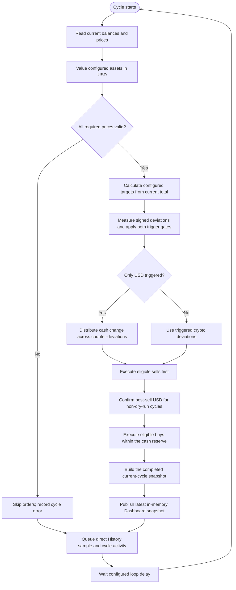

# Rebalancing Algorithm

This document describes the active rebalance cycle and the current portfolio
surfaces. The cycle uses the configured allocation directly, including its
configured USD percentage target. Its dollar target scales with the current
portfolio total. The History page reports direct cycle samples, synchronized
Kraken trade and ledger records, and a separate daily account-value estimate
derived from imported balances and historical prices. Historical reporting does
not change rebalancing math or calculate Buy & Hold performance. Current
planning does not use ATH/drawdown deployment.

## Overview



## Portfolio targets and values

The allocation is a set of configured asset weights totaling 100% and including
USD. For each cycle, the analyzer reads current account balances and USD marks
for the configured non-USD assets. USD is valued at one dollar. A missing or
zero non-USD ticker mark fails valuation and prevents order generation for that
cycle.

Before ticker analysis, each configured non-USD asset must have explicit Kraken
asset metadata with class `currency`. Missing metadata, an unknown class, or a
non-currency class stops the cycle before prices or orders are evaluated. The
private balance response supplies asset amounts but does not attach the generic
ledger `assetClass`; the public asset-info contract currently distinguishes
`currency` and `tokenized_asset` (xStocks). The rebalancer therefore fails
closed for tokenized or unclassified configured assets and does not infer an
asset class from its ticker. See Kraken's [Get Account Balance](https://docs.kraken.com/api-reference/account-data/get-account-balance)
and [Get Asset Info](https://docs.kraken.com/api-reference/market-data/get-asset-info)
contracts. This active-trading eligibility check is separate from History's
ledger evidence: History excludes rows explicitly classified as `equity`,
retains USD cash changes, and never guesses equity from a symbol.

For portfolio value `V` and asset `i`:

```text
rawValue[i]     = balance[i] × priceUSD[i]
currentValue[i] = round_to_cents(rawValue[i])
V               = round_to_cents(sum(rawValue[i]))
USD target       = sum(configured USD target weights)
crypto scale    = (100% − USD target) / sum(configured non-USD target weights)
targetWeight[i] = configured weight[i] × crypto scale       (non-USD assets)
targetValue[i]  = round_to_cents(V × targetWeight[i] / 100)
USD targetValue = round_to_cents(V × USD target / 100)
deviationUSD[i] = currentValue[i] − targetValue[i]
```

The configured USD percentage remains fixed across cycles, while its target
dollar value is recalculated from the current portfolio total each cycle. A 5%
USD target is $1,000 at a $20,000 portfolio value and $2,000 at $40,000. The
remaining portfolio weight is divided among non-USD assets in the proportions already
specified by their configured weights. Current plans do not use portfolio ATH,
drawdown, historical capital flows, historical price highs, or Buy & Hold
results to adjust orders.

The Dashboard snapshot uses the cycle's final available balances and prices. If
orders were planned, the manager refreshes balances and prices after execution;
if that refresh fails, it records a cycle error and uses the pre-trade values as
a fallback snapshot. A cycle that cannot produce a valid valuation does not
publish a new snapshot.

## Deviation and trigger rules

For each asset, the signed dollar deviation is current value minus target value:
positive means overweight and negative means underweight. Relative deviation is
`deviationUSD / targetValue × 100`. A valued holding with a zero target uses a
100% relative deviation so it can still be considered for liquidation; a zero
holding at a zero target has no deviation.

A configured asset triggers only when both conditions hold:

1. The absolute relative deviation is at least `deviationTriggerPercent`.
2. The absolute dollar deviation is at least `minimumOrderSizeUSD`.

USD is never sent as an order row. It can request a fiat correction when it is
the only triggered asset:

- A positive USD deviation means cash is above target. Its surplus is
  distributed among underweight configured non-USD assets in proportion to
  their underweight dollar deviations.
- A negative USD deviation means cash is below target. The shortfall is
  distributed among overweight configured non-USD assets in proportion to
  their overweight dollar deviations.
- If a crypto asset already triggered, its buy/sell plan is used and the USD
  deviation does not create a second correction plan.
- If there are no counter-balancing assets, no fiat correction orders are
  generated.

The minimum-order threshold is checked during planning and checked again at
execution after the requested USD amount is converted to an eight-decimal asset
volume. A sell volume is capped at the cycle-entry holding. No zero or negative
volume is submitted.

## Cycle sequence

1. **Read and value.** Fetch the configured balances and direct ticker prices,
   calculate per-asset values, and validate required prices.
2. **Plan.** Use configured weights and the deviation rules above to create
   typed buy, sell, and activity events.
3. **Sell.** Submit eligible sells before buys to create cash. Definite failures
   do not add projected proceeds. An uncertain live submission stops the
   remaining batch.
4. **Settle cash.** In a non-dry-run cycle with a successful sell, confirm the
   available USD before buying. Matching Kraken fill history is preferred when
   transaction IDs are available; observed spendable balance caps confirmed
   proceeds. A bounded USD balance poll is the fallback when fill evidence is
   missing or materially short. If no positive spendable USD is confirmed, the
   buy phase stops.
5. **Buy.** Limit the entire buy batch to 99% of post-sell cash, rounded down
   to cents. Each successful buy reduces the remaining cycle budget. Apply the
   minimum-order and volume checks again after budget adjustment.
6. **Publish.** Build a snapshot with the cycle actions, final available
   valuation, configured targets, and deviations. Publish it to in-memory
   `CurrentPortfolioState` as the latest Dashboard and SSE snapshot; the state
   also maintains the bounded, source-scoped hero trend window.
7. **Record History.** Queue the selected direct cycle sample and activity for
   asynchronous persistence. History storage and exchange synchronization are
   separate from the order path.
8. **Wait.** Sleep for `loopDelaySeconds`, unless a settings update replaces the
   idle delay after the active cycle session exits.

## Live-order safety

`simulation` and `dryRun` are distinct settings:

- `simulation: true` routes exchange operations to the offline emulator and
  records cycle values in a process-scoped simulation History series; it cannot
  authenticate an account or synchronize Kraken trades and ledgers.
- `dryRun: true` calculates and logs intended orders on the selected backend
  without placing orders.
- A live order is possible only when simulation and dry run are both off.

Before real live submission, the execution journal must be ready, account
binding must be verified, and there must be no unresolved live-order intent. The
journal persists a `PENDING` intent with a deterministic Kraken `cl_ord_id`
before each AddOrder request. A definite exchange rejection resolves the
intent. An ambiguous transport or response outcome is recorded as
`UNCERTAIN`, aborts the remaining order batch, blocks later live submissions,
and makes readiness unavailable until an operator verifies Kraken and resolves
the intent with evidence. AddOrder is attempted once; an ambiguous result is
not retried automatically.

Order intents and account binding are stored in `execution.db`; History samples
and synchronized exchange records use a separate `history.db`. Both files live
in the configured data directory, whose `account-identity.sha256` pins
account-scoped data to one verified Kraken account. The new stores are
initialized explicitly and do not migrate the former reporting or Actual
databases. See the [execution-journal storage notes](../SECURITY.md#execution-journal-storage-and-recovery)
for initialization and backup requirements.

## Dashboard, health, and readiness

`CurrentPortfolioState` publishes the latest completed cycle through an
in-memory `StateFlow` and retains up to 24 recent snapshots from the same
portfolio source for the Dashboard hero trend. The source combines simulation
mode with the adapter's non-secret credential scope; a source change clears the
trend. It appears after the second comparable cycle, resets on restart, and does
not read persisted history. `/api/status/stream` sends current snapshots over
SSE. The Dashboard's STREAM/STALE chip describes feed freshness and remains
separate from the persistent Simulation / Dry Run / Live Trading mode plate.

Health and readiness describe current operation: loop and cycle state, active
mode, latest snapshot, and unresolved live-order intent status. Readiness is
unavailable while the loop is paused/stopped or unhealthy, configuration or
diagnostics are unavailable, there is no current-cycle snapshot, the latest
cycle has an operational error, or an unresolved live-order intent remains.

The Dashboard remains a latest-cycle view with a separate process-local trend.
The `/history` page reads persisted cycle observations and Kraken trade, ledger,
and balance-checkpoint records from the account-scoped History store.

## Account History values and exchange records

The bounded History writer records the cycle's selected direct balances,
direct ticker marks, request windows, account or simulation scope, and
completeness status. It persists asynchronously after the cycle has captured
its data, so History storage failure does not block rebalance execution. An
incomplete sample has no total value; the chart does not fill missing periods
or substitute historical prices. Simulation samples use a separate process
session and are not authenticated account observations.

For an authenticated account, `/api/history/sync/start` starts bounded,
cursor-based Kraken Trades and Ledgers scans. A page is committed before the
next is requested. The synchronizer checks the authenticated account and
credential scope around each page and verifies the active data-directory
account binding before storing data. A changed account or managed-asset scope
cannot be joined to another value series. The History page provides time
ranges, event filters, paginated trade and ledger tables, and exchange-reported
balance checkpoints.

`HistoryValuationCoordinator` runs outside the portfolio cycle and reuses those
committed records. It derives the latest 365 completed UTC daily balance marks
from ledger post-balances and verified coverage, obtains same-day completed
Kraken daily candles for nonzero holdings, and atomically publishes a generation
with per-asset evidence. Missing checkpoints, coverage, or prices remain
unavailable with a dated reason; a partial subtotal is never presented as the
account total. Direct USD markets are preferred, with same-day BTC then EUR
conversion only when required. USD is valued at par. All equity-class share
units are excluded from holdings and totals, while every USD ledger change,
including stock-trade settlements and dividend credits, remains cash. Derivatives and
unidentifiable wallet scopes are outside this release. Conflicting `currency`
and `equity` classifications for the same normalized asset block the full daily
account total. A change in account value requires two complete daily values;
single-day ranges still show the available value and extrema. The reported
change includes deposits and withdrawals and is not profit, performance, TWR,
IRR, or Buy & Hold. These derived values are read-only reporting data and do not
feed portfolio planning or order execution.

An explicit Kraken `EQuery:Unknown asset pair` response marks only that market
as unavailable and permits same-day BTC or EUR fallback. Rate-limit, network,
and malformed-response failures retain their error and retry behavior; they are
not treated as evidence that a market is absent. Every conversion leg must use
the requested UTC day's completed candle. Cached USD prices are valid only at
exactly 1 USD and are repaired to par when stale or off-par.

Daily chart, holdings, status, and export reads materialize the selected values
and their asset details in one deferred SQLite read transaction. The bounded
snapshot is capped at 20,000 daily rows and fails explicitly above that limit.
CSV chunks are emitted after the read transaction closes. A browser holdings
response is applied only while its requested date and account/scope selection
remain current.

See the [History section in the User Guide](USER_GUIDE.md#history) for the
operator-facing behavior and limitations.

## Active settings and compatibility

| Setting | Role |
| --- | --- |
| `loopDelaySeconds` | Delay between rebalance cycles. |
| `deviationTriggerPercent` | Minimum relative deviation required for planning. |
| `minimumOrderSizeUSD` | Minimum significant dollar deviation and execution notional. |
| `dryRun` | Suppresses order placement on the selected backend. |
| `simulation` | Selects the offline exchange emulator. |
| `allocations` | Configured asset symbols, target weights, and presentation colors; weights include USD and sum to 100%. |
| `qualityScores` | Optional Settings inputs for suggesting target weights; scores do not change orders unless the suggested allocations are applied and saved. |

Older JSON may contain retired history-only fields such as
`fiatMaxDrawdown`, `fiatDeploymentExponent`,
`fiatDeploymentThresholdPercent`, `inceptionDate`, and `comparisonStartDate`.
The config parser discards these fields when loading; the next Settings save
writes the active configuration without them. They do not affect current
rebalance targets.

## Precision

Money and asset calculations use `BigDecimal`. Crypto balances, prices, and
order volumes use eight decimal places; USD values use two decimal places;
relative deviations use four decimal places during analysis. Per-asset USD
values are rounded to cents before order sizing, and total portfolio value is
summed from raw asset values and rounded once.
