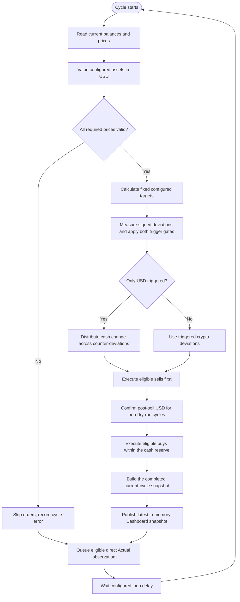

# Rebalancing Algorithm

This document describes the active rebalance cycle and the current portfolio
surfaces. The cycle uses the configured allocation directly, including its
fixed USD target. Retrospective History reporting, history reconstruction,
and retrospective comparisons are retired. Current planning does not use
ATH/drawdown deployment.

## Overview



## Portfolio targets and values

The allocation is a set of configured asset weights totaling 100% and including
USD. For each cycle, the analyzer reads current account balances and USD marks
for the configured non-USD assets. USD is valued at one dollar. A missing or
zero non-USD ticker mark fails valuation and prevents order generation for that
cycle.

For portfolio value `V` and asset `i`:

```text
rawValue[i]     = balance[i] × priceUSD[i]
currentValue[i] = round_to_cents(rawValue[i])
V               = round_to_cents(sum(rawValue[i]))
USD target       = sum(configured USD target weights)
crypto scale    = (100% − USD target) / sum(configured non-USD target weights)
targetWeight[i] = configured weight[i] × crypto scale       (non-USD assets)
targetValue[i]  = round_to_cents(V × targetWeight[i] / 100)
USD targetValue = round_to_cents(V × USD target / 100)
deviationUSD[i] = currentValue[i] − targetValue[i]
```

The configured USD percentage remains fixed across cycles. The remaining
portfolio weight is divided among non-USD assets in the proportions already
specified by their configured weights. Current plans do not use portfolio ATH,
drawdown, historical capital flows, historical price highs, or Buy & Hold
results to adjust orders.

The Dashboard snapshot uses the cycle's final available balances and prices. If
orders were planned, the manager refreshes balances and prices after execution;
if that refresh fails, it records a cycle error and uses the pre-trade values as
a fallback snapshot. A cycle that cannot produce a valid valuation does not
publish a new snapshot.

## Deviation and trigger rules

For each asset, the signed dollar deviation is current value minus target value:
positive means overweight and negative means underweight. Relative deviation is
`deviationUSD / targetValue × 100`. A valued holding with a zero target uses a
100% relative deviation so it can still be considered for liquidation; a zero
holding at a zero target has no deviation.

A configured asset triggers only when both conditions hold:

1. The absolute relative deviation is at least `deviationTriggerPercent`.
2. The absolute dollar deviation is at least `minimumOrderSizeUSD`.

USD is never sent as an order row. It can request a fiat correction when it is
the only triggered asset:

- A positive USD deviation means cash is above target. Its surplus is
  distributed among underweight configured non-USD assets in proportion to
  their underweight dollar deviations.
- A negative USD deviation means cash is below target. The shortfall is
  distributed among overweight configured non-USD assets in proportion to
  their overweight dollar deviations.
- If a crypto asset already triggered, its buy/sell plan is used and the USD
  deviation does not create a second correction plan.
- If there are no counter-balancing assets, no fiat correction orders are
  generated.

The minimum-order threshold is checked during planning and checked again at
execution after the requested USD amount is converted to an eight-decimal asset
volume. A sell volume is capped at the cycle-entry holding. No zero or negative
volume is submitted.

## Cycle sequence

1. **Read and value.** Fetch the configured balances and direct ticker prices,
   calculate per-asset values, and validate required prices.
2. **Plan.** Use configured weights and the deviation rules above to create
   typed buy, sell, and activity events.
3. **Sell.** Submit eligible sells before buys to create cash. Definite failures
   do not add projected proceeds. An uncertain live submission stops the
   remaining batch.
4. **Settle cash.** In a non-dry-run cycle with a successful sell, confirm the
   available USD before buying. Matching Kraken fill history is preferred when
   transaction IDs are available; observed spendable balance caps confirmed
   proceeds. A bounded USD balance poll is the fallback when fill evidence is
   missing or materially short. If no positive spendable USD is confirmed, the
   buy phase stops.
5. **Buy.** Limit the entire buy batch to 99% of post-sell cash, rounded down
   to cents. Each successful buy reduces the remaining cycle budget. Apply the
   minimum-order and volume checks again after budget adjustment.
6. **Publish.** Build a snapshot with the cycle actions, final available
   valuation, configured targets, and deviations. Publish only the latest
   completed snapshot to in-memory `CurrentPortfolioState` for Dashboard and
   SSE consumers.
7. **Observe Actual.** Queue direct balance and ticker evidence for asynchronous
   Actual capture. Observation storage is separate from the order path.
8. **Wait.** Sleep for `loopDelaySeconds`, unless a settings update replaces the
   idle delay after the active cycle session exits.

## Live-order safety

`simulation` and `dryRun` are distinct settings:

- `simulation: true` routes exchange operations to the offline emulator and
  cannot create authenticated Actual observations.
- `dryRun: true` calculates and logs intended orders on the selected backend
  without placing orders.
- A live order is possible only when simulation and dry run are both off.

Before real live submission, the execution journal must be ready, account
binding must be verified, and there must be no unresolved live-order intent. The
journal persists a `PENDING` intent with a deterministic Kraken `cl_ord_id`
before each AddOrder request. A definite exchange rejection resolves the
intent. An ambiguous transport or response outcome is recorded as
`UNCERTAIN`, aborts the remaining order batch, blocks later live submissions,
and makes readiness unavailable until an operator verifies Kraken and resolves
the intent with evidence. AddOrder is attempted once; an ambiguous result is
not retried automatically.

Order intents and account binding are stored in the separate execution
database. The legacy `kraken-rebalancer.db` file remains for safe execution
journal migration and account-history continuity during binding. It is not an
active reporting destination; retired report synchronization, reconstruction,
and writes do not run, and existing files and tables are left untouched. Actual
observations use their separate append-only store. See the [execution-journal
recovery runbook](../SECURITY.md#execution-journal-storage-and-recovery) for
storage and migration procedures.

## Dashboard, health, and readiness

`CurrentPortfolioState` holds an in-memory `StateFlow` containing only the
latest completed cycle snapshot. It does not retain a historical timeline. The
Dashboard renders that snapshot and its current-cycle actions; `/api/status/stream`
sends snapshot updates over SSE. The Dashboard's STREAM/STALE chip describes
feed freshness and remains separate from the persistent Simulation / Dry Run /
Live Trading mode plate.

Health and readiness describe current operation: loop and cycle state, active
mode, latest snapshot, and unresolved live-order intent status. Readiness is
unavailable while the loop is paused/stopped or unhealthy, configuration or
diagnostics are unavailable, there is no current-cycle snapshot, the latest
cycle has an operational error, or an unresolved live-order intent remains.

The former `/history` page permanently redirects to `/actual`. Former
`/api/history/*` reporting endpoints return **410 Gone**.

## Actual raw observations and prospective Buy & Hold

Actual records direct observations for configured managed assets. It stores the
Balance response, direct USD ticker marks, local request windows, account/scope
evidence, and incomplete samples in a separate append-only database. It does
not fill gaps or substitute historical prices. The dispatcher verifies the
established account binding and writes asynchronously, so collection or storage
problems can skip a sample without changing an order decision. Simulation does
not contribute authenticated Actual observations.

An optional prospective Buy & Hold comparison remains available when an
eligible complete observation and verified event continuity provide a safe
starting point. It compares values moving forward from that baseline. It does
not backdate a baseline, reconstruct an earlier period, or influence the
rebalance plan. See the [Actual section in the User Guide](USER_GUIDE.md#actual-observations)
for evidence scope, limitations, and display behavior.

## Active settings and compatibility

| Setting | Role |
| --- | --- |
| `loopDelaySeconds` | Delay between rebalance cycles. |
| `deviationTriggerPercent` | Minimum relative deviation required for planning. |
| `minimumOrderSizeUSD` | Minimum significant dollar deviation and execution notional. |
| `dryRun` | Suppresses order placement on the selected backend. |
| `simulation` | Selects the offline exchange emulator. |
| `allocations` | Configured asset symbols, target weights, and presentation colors; weights include USD and sum to 100%. |
| `qualityScores` | Optional Settings inputs for suggesting target weights; scores do not change orders unless the suggested allocations are applied and saved. |

Older JSON may contain retired history-only fields such as
`fiatMaxDrawdown`, `fiatDeploymentExponent`,
`fiatDeploymentThresholdPercent`, `inceptionDate`, and `comparisonStartDate`.
The config parser discards these fields when loading; the next Settings save
writes the active configuration without them. They do not affect current
rebalance targets.

## Precision

Money and asset calculations use `BigDecimal`. Crypto balances, prices, and
order volumes use eight decimal places; USD values use two decimal places;
relative deviations use four decimal places during analysis. Per-asset USD
values are rounded to cents before order sizing, and total portfolio value is
summed from raw asset values and rounded once.
