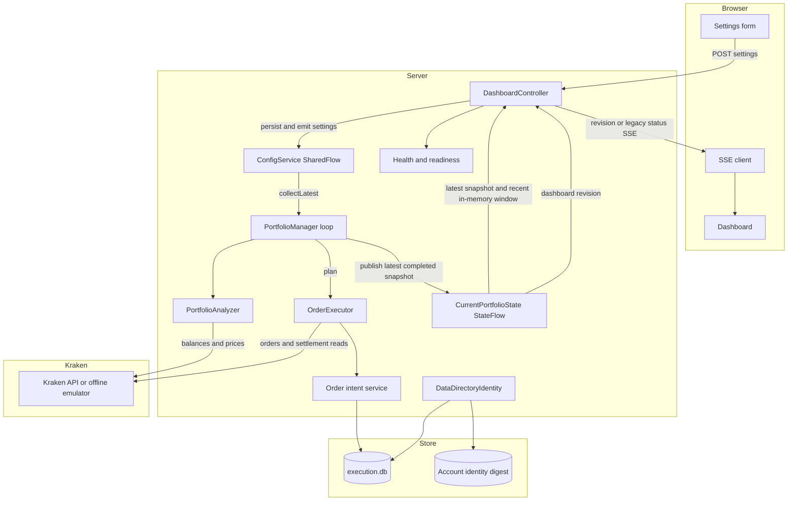
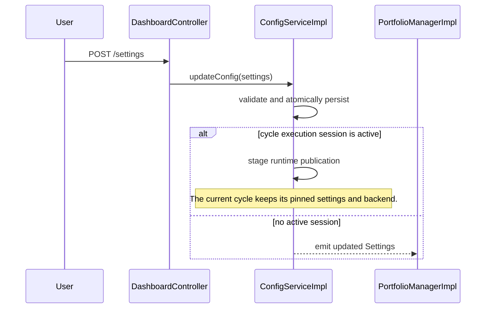
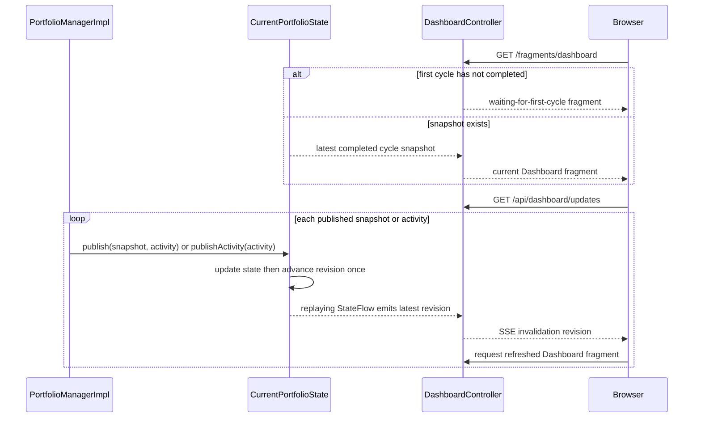

# Kotlin Flow and Runtime Data Paths

This document describes the active runtime paths for Settings, current-cycle
Dashboard updates, and live-order safety.

## Flow types in use

| Type | Active use | Behavior |
| --- | --- | --- |
| Cold Flow | Kraken API retries and sell-settlement polling | Runs when collected; each collection performs its own request or polling sequence. |
| Hot SharedFlow | Configuration changes | Publishes saved settings to the running portfolio loop. |
| Hot StateFlow + bounded memory | CurrentPortfolioState | Exposes the latest completed cycle, a dashboard invalidation revision, and up to 2,880 same-source snapshots in process memory for the hero chart; clears the window when simulation mode or credential scope changes. |

## System map

DataDirectoryIdentity and the execution journal account binding keep live-order
records associated with one verified Kraken account. The journal is initialized
on first start in a fresh data directory. The application does not store cycle
snapshots or reconstruct portfolio values from past activity.

## Configuration changes

Path: Settings form → DashboardController → ConfigService → PortfolioManagerImpl

ConfigServiceImpl exposes a hot SharedFlow with the current settings replayed
to a new collector. The loop uses collectLatest, so a change replaces an idle
delay promptly. A setting saved during a cycle is persisted at once, then
published for later cycles after the active execution session exits.

## Current-cycle Dashboard updates

Path: PortfolioManagerImpl → CurrentPortfolioState → Dashboard fragment and
/api/dashboard/updates → browser

The Dashboard stream carries only a revision used to invalidate the current
fragment. It does not serialize snapshot data; the fragment remains the source
of truth. Snapshot publication with activity advances the revision once, and an
activity-only publication (such as a failed cycle without a snapshot) also
advances it so the activity feed refreshes.

`/api/status/stream` remains available with its existing snapshot-JSON and
activity-cycle-ID messages for compatibility. The Dashboard shell uses the
revision-only `/api/dashboard/updates` endpoint.

CurrentPortfolioState exposes the latest completed cycle through a StateFlow
and retains up to 2,880 recent snapshots from the same portfolio source in a
bounded in-memory window for the Dashboard hero chart (about 24 hours of
configured delay at 30 seconds between cycles, plus cycle execution time). The
source combines
simulation mode with the adapter's non-secret credential scope, and a change
clears the window. The window starts empty on process startup. The chart appears
after two comparable cycles and resets when the process restarts or the source
changes. Recent cycle activity is also process-local. The STREAM/STALE chip
reports SSE freshness; the persistent mode plate reports Simulation, Dry Run,
or Live Trading independently.

The Dashboard health and readiness endpoints describe current operation: loop
state, cycle timestamps and error, latest snapshot, active mode, and unresolved
live-order intent status. Readiness is unavailable until the loop runs,
configuration and diagnostics are available, a cycle snapshot exists, the
latest cycle has no operational error, and no unresolved live-order intent
remains. The dashboard invalidation SSE carries revisions; the legacy status
stream retains current-cycle snapshot JSON and activity-cycle IDs.

## Live-order intent and readiness

A real live order is recorded in execution.db before Kraken AddOrder is called.
A definite rejection resolves the intent as rejected. An ambiguous transport or
response failure becomes UNCERTAIN and stops the remaining live batch.
Unresolved intents block later live orders and keep the application unready
until an operator verifies the exchange state and resolves the journal entry
with evidence.

The execution journal and its account binding are part of live-order safety.
A file-backed journal is required before real live-order submission; without
durable pending and uncertain states, a restart could repeat an order that
Kraken had already accepted.

## USD settlement after sells

Path: OrderExecutorImpl → OrderSettleHelper → Kraken API

After successful sells, the executor confirms available USD before issuing
buys. When Kraken returns sell transaction IDs, settlement checks matching
TradesHistory fills, caps confirmed proceeds to observed spendable USD, and
uses projected post-sell cash as the cap if the spendable-balance peek fails.
An absent or zero USD entry in a successful balance read is zero spendable cash,
not a failed peek eligible for the projected-cash fallback.
Settlement falls back to bounded USD balance polling when fill evidence is
missing or materially short. This is order-specific fill confirmation. If safe
cash cannot be confirmed, buys are stopped for that cycle.

The exchange reads and polling use cold flows. A collection starts the work;
normal coroutine cancellation stops it. The cycle-wide execution session keeps
the settings and selected live/simulation backend stable during planning,
orders, and this settlement.
