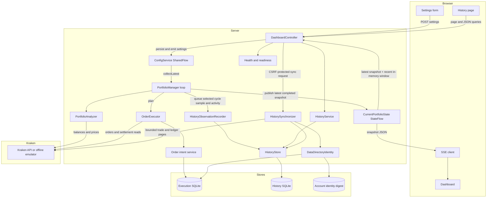
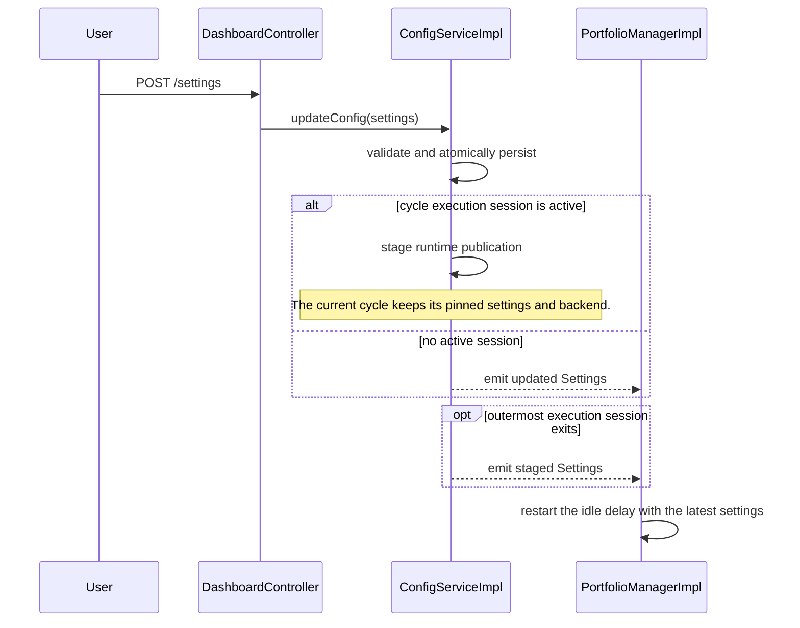
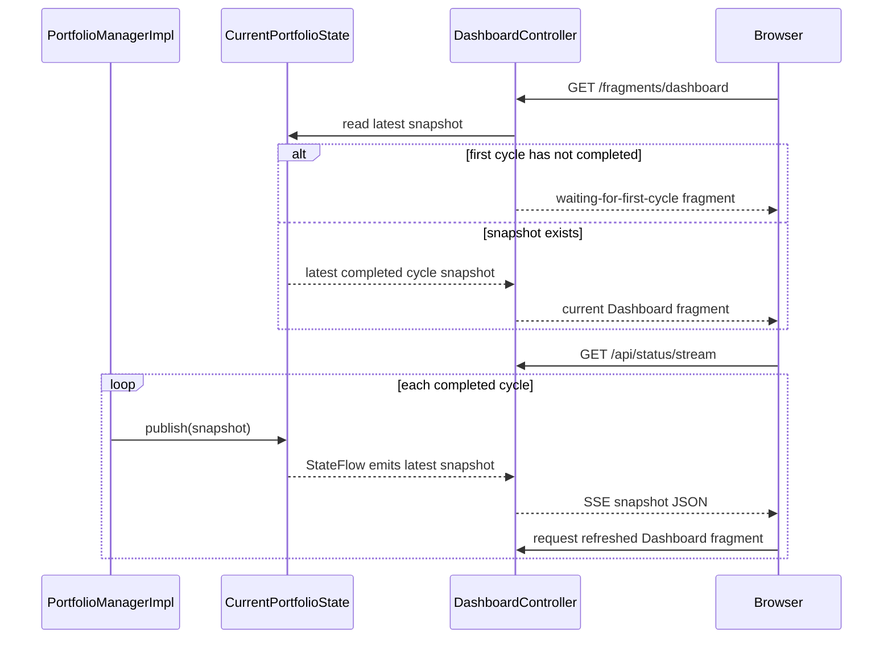

# Kotlin Flow and Runtime Data Paths

This document describes the active runtime paths for configuration, the current
Dashboard snapshot, account History capture and synchronization, and live-order
safety.

## Flow types in use

| Type | Active use | Behavior |
| --- | --- | --- |
| Cold `Flow` | Kraken API retries and sell-settlement polling | Runs when collected; each collection performs its own request/poll sequence. |
| Hot `SharedFlow` | Configuration changes | Publishes saved settings to the running portfolio loop. |
| Hot `StateFlow` + bounded memory | `CurrentPortfolioState` | Exposes the latest completed cycle and retains up to 24 same-source snapshots in process memory for the Dashboard hero chart; clears the window when simulation mode or credential scope changes. |
| Bounded channel | History cycle recorder | Buffers selected cycle samples and activity so persistence stays outside the order path. |

## System map

The account identity digest binds the active data directory's History and
execution stores to one verified Kraken account. The application uses explicit
fresh-schema initialization and normal startup refuses to recreate missing
stores. It does not read or migrate the former reporting or Actual databases.
The History value series contains direct cycle observations; synchronized
trades, ledgers, and ledger balances are displayed as exchange evidence rather
than used to reconstruct an earlier portfolio value.

## Configuration changes

**Path:** Settings form → `DashboardController` → `ConfigService` →
`PortfolioManagerImpl`

`ConfigServiceImpl` exposes a hot `SharedFlow` with the current settings
replayed to a new collector. The loop uses `collectLatest`, so a change replaces
an idle delay promptly. A setting saved during a cycle is persisted at once,
then published for later cycles after the active execution session exits.

## Current-cycle Dashboard updates

**Path:** `PortfolioManagerImpl` → `CurrentPortfolioState` → Dashboard fragment
and `/api/status/stream` → browser

`CurrentPortfolioState` exposes the latest completed cycle through a `StateFlow`
and retains up to 24 recent snapshots from the same portfolio source in a
bounded in-memory window for the Dashboard hero chart. The source combines
simulation mode with the adapter's non-secret credential scope, and a change
clears the window. The window starts empty on process startup and is never
loaded from `history.db`. The chart appears after two comparable
cycles and resets when the process restarts or the source changes. The Dashboard
also shows activity from the latest cycle. Its STREAM/STALE chip reports SSE
freshness; the persistent mode plate reports Simulation, Dry Run, or Live
Trading independently.

The Dashboard's health and readiness endpoints describe current operation:
loop state, cycle timestamps and error, latest snapshot, active mode, and
unresolved live-order intent status. Readiness is unavailable until the loop
runs, configuration and diagnostics are available, a cycle snapshot exists,
the latest cycle has no operational error, and no unresolved live-order intent
remains. SSE carries current-cycle snapshots only.

## Live-order intent and readiness

A real live order is recorded in the separate execution database before Kraken
AddOrder is called. A definite rejection resolves the intent as rejected. An
ambiguous transport or response failure becomes `UNCERTAIN` and stops the
remaining live batch. Unresolved intents block later live orders and keep the
application unready until an operator verifies the exchange state and resolves
the journal entry with evidence.

The execution journal and its account binding are part of the live-order safety
path. `DataDirectoryIdentity` pins the active execution and History stores to
one verified Kraken account. Account binding does not consult a legacy reporting
store or reconstruct portfolio values from exchange events.

## USD settlement after sells

**Path:** `OrderExecutorImpl` → `OrderSettleHelper` → Kraken API

After successful sells, the executor confirms available USD before issuing
buys. When Kraken returns sell transaction IDs, settlement checks matching
`TradesHistory` fills, caps confirmed proceeds to observed spendable USD, and
falls back to bounded USD balance polling when fills are missing or materially
short. This is order-specific fill confirmation; it does not synchronize
account history or produce retrospective reports. If safe cash cannot be
confirmed, buys are stopped for that cycle.

The exchange reads and polling use cold flows. A collection starts the work;
normal coroutine cancellation stops it. The cycle-wide execution session keeps
the settings and selected live/simulation backend stable during planning,
orders, and this settlement.

## Account History capture and synchronization

**Cycle sample path:** completed cycle balance and ticker evidence → bounded
`HistoryObservationRecorder` queue → `HistoryStore` → `history.db`

The portfolio loop submits its selected cycle sample and activity after the
cycle work. The recorder performs account verification and SQLite persistence
asynchronously, so missing direct evidence, a full queue, or storage failure
cannot block order execution. Each sample stores its account or simulation
scope, managed-asset scope, observation time, request windows, and completeness
status. Incomplete samples do not have a total value; the chart does not infer
values across them.

**Exchange history path:** History page → CSRF-protected
`POST /api/history/sync/start` → `HistorySynchronizer` → Kraken Trades or
Ledgers page → `HistoryStore`

The synchronizer processes one bounded page at a time and commits its cursor
and records before requesting the next page. It pins the current account and
execution session across identity verification, page fetch, and commit, and
checks that the authenticated identity remains stable around the exchange read.
The shared data-directory identity digest must match before account-scoped data
is written. A failed page gets one bounded restart; further failures remain
visible in the feed's sync status. The History UI exposes per-feed progress,
time ranges, event filters, paginated trade and ledger tables, a portfolio-value
chart, and ledger-reported balance checkpoints.

`HistorySyncCoordinator` owns automatic account synchronization. Once an
authenticated identity is verified, a periodic trigger runs every 60 seconds.
The first recent scan covers 24 hours; later scans overlap the last completed
window by 24 hours so late exchange records can be picked up. A qualifying live
order submission requests a nonblocking recent refresh after five seconds;
conflated requests do not cancel a scan already in progress. A frozen, durable
backfill continues from its committed per-feed cursor, yielding between pages
when recent work arrives and resuming after restart. The backfill window is
frozen at the earliest second the account's API key permits and reopens when the
key later permits older history. A seven-day repair window
is rechecked daily; the repair keeps its own frozen window and cursor and yields
between pages to a pending recent refresh. Every successfully scanned interval is
merged into a durable per-feed coverage union, so a rolling refresh keeps the
periods it already covered. Transient failures use a jittered 1, 2, 5, then 15 minute
retry schedule until the operation succeeds; account-scope changes and API-key
restriction changes block that sync until an operator selects **Retry**. Simulation scopes do not
fetch Kraken trades or ledgers.

The Data status page reads coordinator revisions and per-feed jobs. A new
revision refreshes affected History panels in the open page without navigation;
the client retains the selected range, scope, page, chart viewport, and scroll
position.

The reporting service derives period extrema and first-to-last value changes
from complete direct samples. Trade volume and fees remain grouped by the
exchange-reported currency; funding and rewards remain in native asset units.
No historical amount is converted using a nearest portfolio-cycle price.

History write transactions use SQLite `IMMEDIATE` mode, acquiring the writer
reservation before reading transaction state. Sync startup/status changes and
asynchronous cycle recording can overlap; acquiring the writer first avoids a
deferred read-to-write upgrade failing immediately with `SQLITE_BUSY`. The
existing five-second busy timeout bounds contention with another writer.
Page exceptions are logged with their stack traces, feed, scan, window, and
restart count. Failures outside page handling are also logged by the background
job before propagation. Cancellation is propagated without a failure log.

Simulation cycle samples use an independent process-session scope. Simulation
does not authenticate an account or synchronize Kraken trades and ledgers, so
its values are not represented as account history. The Dashboard's latest
snapshot and in-memory trend remain separate from the persisted History series.
