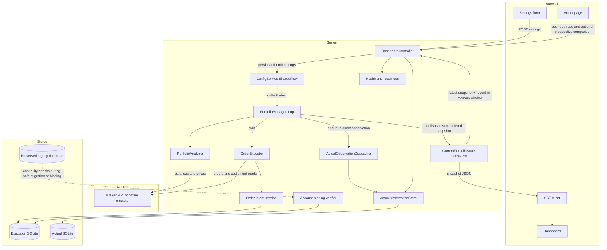
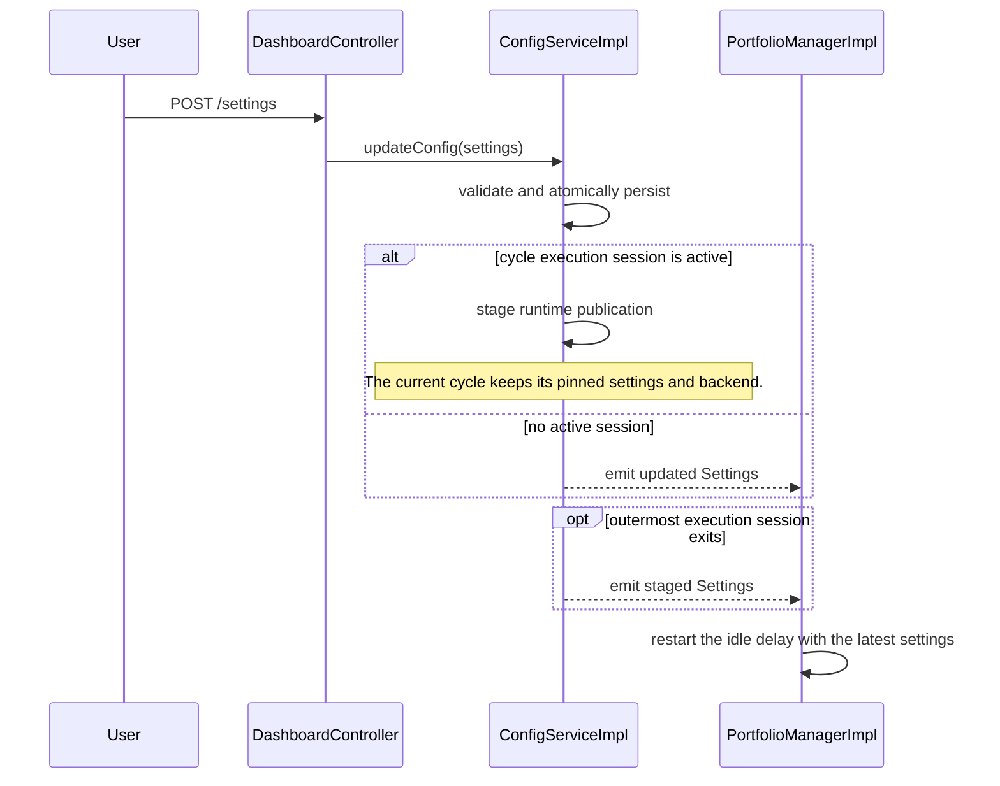
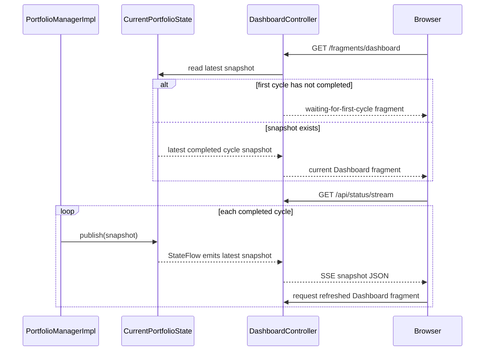

# Kotlin Flow and Runtime Data Paths

This document describes the active runtime paths for configuration, the current
Dashboard snapshot, live-order safety, and Actual observations. Retrospective
History reporting and reconstruction are retired.

## Flow types in use

| Type | Active use | Behavior |
| --- | --- | --- |
| Cold `Flow` | Kraken API retries and sell-settlement polling | Runs when collected; each collection performs its own request/poll sequence. |
| Hot `SharedFlow` | Configuration changes | Publishes saved settings to the running portfolio loop. |
| Hot `StateFlow` + bounded memory | `CurrentPortfolioState` | Exposes the latest completed cycle and retains up to 24 recent snapshots in process memory for the Dashboard hero chart. |
| Bounded channel | Actual observation writer | Buffers a small number of observation candidates so persistence stays outside the order path. |

## System map

The legacy database shown here is retained for safe migration and account-history
continuity checks during binding. It is not an active reporting destination.
The application does not synchronize historical trades or ledgers, reconstruct
retrospective reports, or write new retrospective report data. Existing files
and tables remain untouched.

## Configuration changes

**Path:** Settings form → `DashboardController` → `ConfigService` →
`PortfolioManagerImpl`

`ConfigServiceImpl` exposes a hot `SharedFlow` with the current settings
replayed to a new collector. The loop uses `collectLatest`, so a change replaces
an idle delay promptly. A setting saved during a cycle is persisted at once,
then published for later cycles after the active execution session exits.

## Current-cycle Dashboard updates

**Path:** `PortfolioManagerImpl` → `CurrentPortfolioState` → Dashboard fragment
and `/api/status/stream` → browser

`CurrentPortfolioState` exposes the latest completed cycle through a `StateFlow`
and retains up to 24 recent snapshots in a bounded in-memory window for the
Dashboard hero chart. The window starts empty on process startup and is never
loaded from the reporting database, so it cannot mix retained simulation or
unverified history into the chart. The chart appears after two cycles and resets
when the process restarts. The Dashboard also shows activity from the latest
cycle. Its STREAM/STALE chip reports SSE freshness; the persistent mode plate
reports Simulation, Dry Run, or Live Trading independently.

The Dashboard's health and readiness endpoints describe current operation:
loop state, cycle timestamps and error, latest snapshot, active mode, and
unresolved live-order intent status. Readiness is unavailable until the loop
runs, configuration and diagnostics are available, a cycle snapshot exists,
the latest cycle has no operational error, and no unresolved live-order intent
remains. SSE carries current-cycle snapshots only.

## Live-order intent and readiness

A real live order is recorded in the separate execution database before Kraken
AddOrder is called. A definite rejection resolves the intent as rejected. An
ambiguous transport or response failure becomes `UNCERTAIN` and stops the
remaining live batch. Unresolved intents block later live orders and keep the
application unready until an operator verifies the exchange state and resolves
the journal entry with evidence.

The execution journal and its account binding are part of the live-order safety
path. The preserved legacy store may be consulted for account-history
continuity during a safe migration or initial binding; it is not used to
reconstruct or publish retrospective reports.

## USD settlement after sells

**Path:** `OrderExecutorImpl` → `OrderSettleHelper` → Kraken API

After successful sells, the executor confirms available USD before issuing
buys. When Kraken returns sell transaction IDs, settlement checks matching
`TradesHistory` fills, caps confirmed proceeds to observed spendable USD, and
falls back to bounded USD balance polling when fills are missing or materially
short. This is order-specific fill confirmation; it does not synchronize
account history or produce retrospective reports. If safe cash cannot be
confirmed, buys are stopped for that cycle.

The exchange reads and polling use cold flows. A collection starts the work;
normal coroutine cancellation stops it. The cycle-wide execution session keeps
the settings and selected live/simulation backend stable during planning,
orders, and this settlement.

## Actual observations and prospective Buy & Hold

**Raw observation path:** current cycle direct balance and ticker evidence →
bounded `ActualObservationDispatcher` queue → append-only `ActualObservationStore`

Application startup starts the Actual dispatcher and portfolio manager. The
first completed cycle publishes Dashboard state; startup does not reconstruct
retrospective reports.

The loop enqueues the direct pre-trade balance and price observations after
order execution returns. The dispatcher obtains Kraken's authenticated account
identity, checks that credentials have not changed since the cycle captured its
evidence, values the configured managed assets, and appends the sample
asynchronously. Dry-run observations do not require an existing execution
binding; live-order authorization retains its separate binding checks. A full
queue, verification failure, or storage failure can skip an observation; it
does not block a safe rebalance cycle. Simulation does not add authenticated
Actual observations.

`GET /actual` reads the current account and configured-asset scope from the
Actual store. It returns forward-only raw observations, including incomplete
evidence and gaps. An optional prospective Buy & Hold comparison can start
from an eligible complete observation after event continuity is verified. It
uses observations moving forward from that baseline; it does not reconstruct an
earlier period. Changing allocation weights alone does not change the observed
asset scope, while changing configured assets does.

## Retired History routes

The former `/history` page permanently redirects to `/actual`. Former
`/api/history/*` reporting endpoints return **410 Gone**. Historical sync,
reconstruction, and retrospective report writes no longer run. Existing legacy
database files and tables are left in place for migration and continuity needs.
