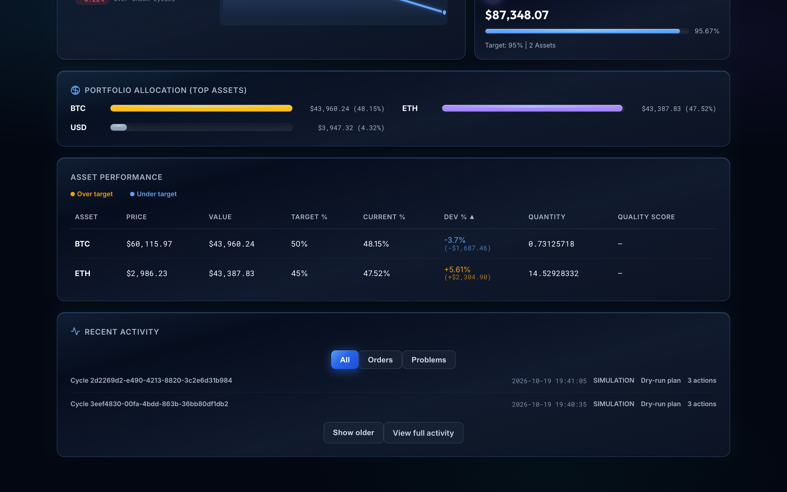
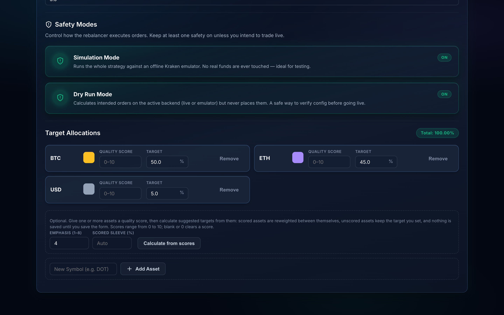
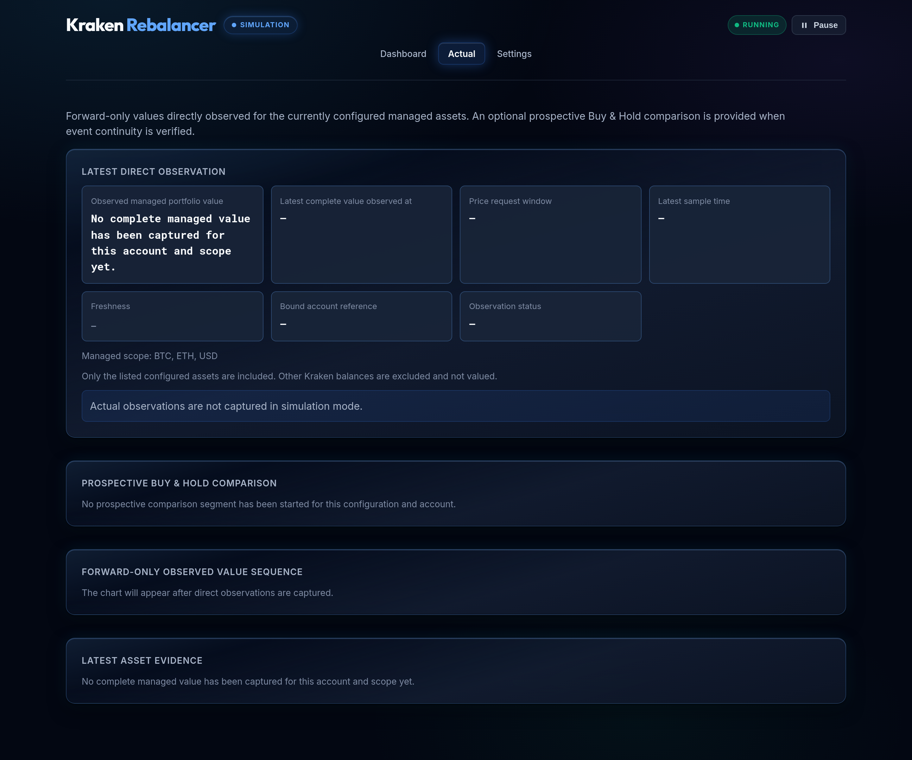

# User Guide — Kraken Rebalancer

This guide walks through the Dashboard, Actual observations, and Settings. It
explains how to read the latest rebalance cycle, configure the bot, and interpret
directly observed account evidence.

For install and first launch, see the [README Getting Started](../README.md#getting-started)
section. For rebalancing math internals, see [ALGORITHM.md](ALGORITHM.md).

---

## What problem does it solve?

Market moves, deposits, and withdrawals cause a portfolio to drift away from its
target allocation. Correcting that drift by hand requires repeated monitoring,
calculations, and order entry. Kraken Rebalancer automates those rules so a
Kraken user can follow a chosen allocation consistently, including a
percentage-based USD cash target that grows or shrinks with the portfolio, and
review what the strategy did from one local dashboard.

This is an execution and monitoring tool, not a source of trading signals. You
choose the assets, targets, and risk settings; the application does not predict
prices or guarantee returns. Rebalancing may create fees and tax consequences.
The simulator and dry-run mode let you decide whether the workflow fits your
strategy before any real order is placed.

For a fuller explanation of the use cases and intended audience, see
[Why Use Kraken Rebalancer?](../README.md#why-use-kraken-rebalancer).

---

## Safety modes (read this first)

Two independent settings control how “real” trading is. Change them from
**Settings** or in `rebalancer-config.json`.

| Mode | What it does | When to use |
| :--- | :--- | :--- |
| **Simulation Mode** | Routes exchange calls to an offline Kraken emulator (random-walk prices). No API keys required. | Learning and demonstrating the UI |
| **Dry Run Mode** | Calculates intended orders on the active backend (live Kraken or the emulator) but never places them. Server logs may show `[DRY RUN]` or `[EMULATOR DRY RUN]`; Recent Activity always prefixes `[DRY RUN]`. | Rehearsing strategies against live or simulated markets |

**Live trading** is `simulation` off **and** `dryRun` off with real API keys —
that moves real funds. Prefer simulation (and/or dry run) until you understand
the screens below.

On **Settings**, these appear as two toggle cards — **Simulation Mode** first,
then **Dry Run Mode** — each with an **ON** / **OFF** state pill and a short line
of consequence prose (e.g. "No real funds are ever touched"). Keep at least one
safety on unless you intend to trade live.

---

## Navigation

Dashboard, Actual, and Settings share the same top nav tabs (active page is
highlighted and centered below the header identity on wider screens). The header
brand reads **Kraken** + **Rebalancer**. A **persistent mode plate** shows the
current trading mode on **every** page: **SIMULATION** (blue), **DRY RUN** (amber), or
**LIVE TRADING** (red).
Precedence is simulation first (even if dry run is also on), then dry run, then
live. The plate reflects your Settings, and hovering it reveals a tooltip
explaining the consequence (e.g. "Live trading — real orders execute with real
funds").
Dashboard updates also refresh the plate, including after Settings are changed
in another tab.

The header also includes a loop control on every page. Its state pill shows
**RUNNING** or **PAUSED**; choose the labeled **Pause** action to stop new rebalance
cycles or **Resume** to start them again. This is separate from the
trading-mode plate: pausing the loop does not change Simulation, Dry Run, or
Live Trading settings.

| Page | Route | Purpose |
| :--- | :--- | :--- |
| **Dashboard** | `/` | Latest completed cycle snapshot, allocation bars, performance table, current-cycle actions |
| **Actual** | `/actual` | Forward-only observed managed value, evidence status, and asset balances |
| **Settings** | `/settings` | Loop timing, triggers, USD percentage target, safety modes, allocations |

Legacy links to `/history` permanently redirect to `/actual`. Retired
`/api/history/*` reporting endpoints return **410 Gone**. The application no
longer offers retrospective trade reports, reconstructed historical
comparisons, or history backfill. Actual retains forward-only raw observations
and its optional prospective Buy & Hold comparison. Operator recovery for
unresolved live orders remains available through the separate safety workflow.

The dashboard pushes live updates over Server-Sent Events (`/api/status/stream`).
**Only the Dashboard** shows a stream-health chip in the header next to the mode
plate: **STREAM** (green) when data is flowing, or **STALE** when the last
snapshot is older than **90 seconds** (governed by
`PrecisionConstants.STALE_THRESHOLD_SECONDS`). Automatic SSE reconnection
resumes feed status without requiring a page reload. Beside it are the relative
age of the last update (e.g. `12s`) and its clock time.

The stream chip describes **feed health, not trading mode** — a healthy
**STREAM** chip does not mean live trading is on. Always read the mode plate for
that.

---

## Dashboard

*Dashboard overview — the latest completed cycle and its current allocation.*

### Portfolio overview

The Dashboard displays the latest completed rebalance cycle: a hero portfolio
value with a short trailing chart plus two tiles:

| Element | Meaning |
| :--- | :--- |
| **Total Portfolio** (hero) | Mark-to-market value of the tracked assets in the latest completed cycle. The adjacent chart shows up to 24 recent completed cycles captured during this application run. |
| **Cash (USD)** (tile) | Fiat balance with a progress bar for its current share, the configured USD target, and deviation. |
| **Crypto Assets** (tile) | Combined crypto value with a progress bar for its share, its target %, and how many crypto symbols you hold. |

The trend uses only in-memory snapshots from the current application run. It
appears after the second completed cycle, shows the cycle count and observed
times, and resets when the application restarts. It does not read older
database snapshots, which may predate the current account or include simulation
data.

### Loop control

The header's loop control is the quickest way to stop trading activity without
changing the saved configuration. When the state reads **RUNNING**, click
**Pause**; the active loop is cancelled safely and the state changes to
**PAUSED**. Click **Resume** when you want the configured cycle schedule to
start again. The control does not alter credentials, allocations, Simulation,
Dry Run, or Live Trading mode.

### Allocation & performance

*Dashboard — current asset performance and over/under-target legend.*

- **Portfolio Allocation (Top Assets)** — Horizontal bars for the largest
  holdings by USD value (and cash), showing up to the **top 15**. Bar lengths are
  relative to the largest holding (the biggest fills the track), with each bar
  labelled by its USD value and current %. Each symbol uses its configured color
  from Settings (BTC/ETH/USD start with amber/violet/slate defaults; other
  assets get an auto-assigned color).
- **Asset Performance** — Sortable table of price, value, target %, current %,
  and **Dev %** (how far each asset is from target, with dollar impact).
  Amber = over target, blue = under target (not profit/loss green/red); a small
  legend sits above the table.
- **Recent Activity** — actions from the latest completed cycle, with a short
  summary and compact timestamps:
  - Red **SELL** / green **BUY** — orders with USD to 2 decimals

*Dashboard — activity from the latest completed cycle.*

Use this page as your “is the bot healthy right now?” view.

### Operational status and readiness

The JSON endpoints are intentionally unauthenticated for this application's
single-operator/private-LAN deployment model. Treat every device that can reach
the server as trusted. `GET /api/health` is a liveness and diagnostic check; it
includes the active mode, loop state, last cycle timestamps/error, and unresolved
live-order counts. `GET /api/readiness` returns `200` only when the loop is
running, configuration is available, a current-cycle snapshot exists, the
latest cycle is not failed, and no ambiguous live-order intent is waiting for
review. It returns `503` with a `readinessReason` otherwise.

If an ambiguous live order occurs, the application halts live trading and displays an
**Action Required: Unresolved Live Order Intent** banner at the top of the Dashboard.
You can inspect the intent details (ID, symbol, side, volume, USD amount, error message)
and resolve it directly from the UI by selecting **CONFIRMED** or **REJECTED**,
entering optional Kraken order transaction IDs, and providing resolution evidence.
Alternatively, inspect `GET /api/order-intents` via REST. Only an `UNCERTAIN` intent is
eligible for resolution (`PENDING` indicates an AddOrder in flight). Follow
the [operator recovery runbook](../SECURITY.md#operator-recovery-runbook) for
the exchange-verification checklist, complete resolution options, and post-request
checks before resuming.

### Responsive layouts

The dashboard is checked at the same common viewport profiles used by the visual
review workflow. On phones, Asset Performance keeps Asset, Value, and Dev % in
view.

---

## Settings

Open **Settings** from the shared top nav, or go to `/settings`.

*Settings — active controls, allocations, and safety mode cards.*

### Global parameters

| Field | Purpose |
| :--- | :--- |
| **Loop Interval (Seconds)** | How often the rebalancer wakes up to snapshot and potentially trade. Minimum **1**. |
| **Deviation Trigger (%)** | Minimum absolute deviation from target before an asset can trigger trades. Minimum **0**. |
| **Minimum Order Size ($)** | Dual role: absolute USD deviation must meet this for an asset to trigger, and orders below this notional are skipped at execution. **Minimum `2` (enforced).** |

Older configuration files may contain retired history-only values such as
drawdown, deployment, inception, or comparison-start settings. These values are
discarded when the file is read and do not affect the active strategy, which
uses configured allocations directly. The next Settings save removes those
retired keys from the JSON file.

### Safety modes

Simulation and Dry Run live in their own **Safety Modes** block (not mixed into
the numeric parameter grid), as two toggle cards each with an **ON** / **OFF**
state pill:

| Card | Purpose |
| :--- | :--- |
| **Simulation Mode** | Runs the whole strategy against an offline Kraken emulator — no real funds are ever touched. |
| **Dry Run Mode** | Calculates intended orders on the active backend (live Kraken or the emulator) but never places them. |

**Simulation Mode** is listed first. **Save Configuration** lives in the page
header next to the nav (not at the bottom of the form). Saving hot-reloads the
running loop — no process restart required. If a rebalance is actively
executing, the file is saved immediately but the new runtime settings take
effect only after that cycle finishes.

Saving fails closed when any numeric field is missing, malformed, or non-finite,
or when allocation rows are incomplete. The current configuration remains
active and the Settings form shows the validation error.

### Target allocations

*Settings — target allocations and optional quality-score preview.*

Each allocation row carries a symbol, a color swatch, an optional **Quality
score**, a **Target** percent, and **Remove**. On wider screens, rows sit in
auto-fitting columns sized for all controls. On phone screens, the symbol and
**Remove** action share the first row, with the swatch, score, and target below;
the two numeric fields stay labelled so a score is never mistaken for a target.
The score-preview and Add Asset controls wrap below their fields when space is
limited.

- Target percent is bounded to **0–100%** by the percent input itself.
- **Quality score** is optional and runs **0–10**. It is a preference input, not
  a target: it never changes what you hold until you press **Calculate from
  scores** and then save.
- Colors persist in `rebalancer-config.json`. The Settings form accepts a blank
  swatch for automatic assignment but rejects malformed nonblank colors.
  Config-file load/save normalization still assigns known defaults for
  BTC/ETH/USD and HSL-derived colors for other missing or invalid values.
- **Total** must read **100.00%** (green badge) before save succeeds.
- **USD is required** — cash is part of the strategy, not optional.
- **Add Asset** / **Remove** change the universe without restarting the app.

#### Calculating targets from quality scores

**What it is.** An optional helper that suggests target percentages from the
quality scores you assign, so you are not hand-tuning numbers you would rather
express as a preference. It only ever produces a *preview*: it rewrites the
target fields in the form and nothing reaches your configuration until you press
**Save Configuration**.

**What it does not do.** It never changes what you hold on its own, and it never
moves money. Until you save, the preview is a calculation you can discard by
pressing **Calculate from scores** with different inputs, or by reloading the
page.

**How to use it.**

1. Give one or more assets a **Quality score** between **0** and **10** in their
   row. Leave a row blank or enter **0** to clear its score; assets without a
   positive score are excluded from the scored sleeve. At least one score is required — with
   none, the form reports *"Enter a quality score for at least one asset before
   calculating"*.
2. Set **Emphasis** to control how hard a higher score wins. The form
   pre-selects **4**.
3. Optionally set **Scored sleeve**, the amount of the book to redistribute.
   Leave it on **Auto** to use the combined current target of the scored assets.
   If those targets sum to zero, the preview reports an error instead of taking
   the whole book as a fallback.
4. Press **Calculate from scores** and read the result.

| Control | Purpose |
| :--- | :--- |
| **Emphasis (1–8)** | Steepness of the split. Each asset's weight is its score raised to this power, so the ratio between two assets grows quickly with the setting. Leave blank for the flattest weighting (1). |
| **Scored sleeve (%)** | How much of the book the scored assets share. **Auto** = the combined current target of the scored assets, which normally leaves unscored assets untouched. |
| **Calculate from scores** | Runs the preview. Nothing is saved until you save the form. |

**How the split works.** Scored assets are reweighted *between themselves*, in
proportion to `score^emphasis`, and that share of the book is then divided among
them. Assets without a score keep the target you already set, which is why the
total still has to come to **100.00%**. The preview is returned only when the
scored sleeve plus the preserved unscored targets stays within the same
allocation tolerance used when saving the configuration.

Worked example — the default targets BTC **50%**, ETH **45%**, USD **5%**, with
BTC scored **9.5** and ETH scored **6.0**. The scored sleeve is 95%, and USD is
untouched either way:

| Emphasis | BTC | ETH | USD (untouched) |
| ---: | ---: | ---: | ---: |
| **1** (flattest) | 58.23% | 36.77% | 5% |
| **4** (pre-selected) | 81.96% | 13.04% | 5% |

**Reading the three figures.** They answer different questions, and each says
which one:

| Figure | What it answers | Scope |
| :--- | :--- | :--- |
| **Weighted quality score** | How strong the scored assets look overall. | **Scored assets only** — an unscored asset has no score to average in. |
| **Largest single position** | Am I concentrated? | The **whole book**, including the targets preserved for unscored assets. |
| **Effective independent bets** | How many genuinely separate positions do I hold? | The **whole book**. `1 / Σ(share²)`: equals the leg count when evenly weighted, and **1** when everything sits in one asset. Two assets at 86 / 14 behave like **1.3** bets, not 2. |

The configured USD percentage target, sell-then-buy sequence, and dust handling are documented in
[ALGORITHM.md](ALGORITHM.md).

---

## Actual observations

*Actual — forward-only observations, with simulation evidence unavailable in this capture.*

The **Actual** page shows a forward-only sequence of directly observed managed
values. It starts when eligible observations begin; it does not reconstruct
earlier balances or prices. Authenticated Actual observations are unavailable
in simulation mode; emulator values are not shown as an account history.

The latest panel emphasizes the most recent complete managed value, its
observation time, the authenticated account reference, freshness, and the latest
sample status. The asset table includes each configured asset's observed
balance, direct USD mark, marked value, portfolio share, target percentage, and
evidence status. On narrow screens, the table presents each row as a labeled
card.

The page uses the configured allocation symbols, including configured USD,
from Kraken's authenticated [Get Account Balance](https://docs.kraken.com/api-reference/account-data/get-account-balance)
response for the authenticated user's default wallet. That endpoint describes
its results as cash balances net of pending withdrawals and notes that
staking/Earn asset extensions may appear. The Actual page is deliberately
narrower than a full-wallet view: it lists the configured assets only, excludes
other wallet balances, and does not merge unconfigured or extended balance keys
into a configured base asset. An absent configured balance is unresolved, not
assumed to be zero.

For non-USD assets, the mark comes directly from the public
[Get Ticker Information](https://docs.kraken.com/api-reference/market-data/get-ticker-information)
response's `c[0]` last-trade field. Kraken's Balance and Ticker requests are
separate, so the page shows both request windows. The sample is incomplete when
either interval is out of order, their combined window from the earliest
request start to the latest response completion exceeds two minutes, or the gap
between the intervals exceeds 60 seconds. A required balance or price that is
missing or invalid also makes the sample incomplete. Source evidence and request
timestamps remain available, but an incomplete sample has no total. The ticker
field has no separate exchange event timestamp in this record; the displayed
price window is the local request interval, not an asserted market-event time.
No historical OHLC price is substituted.

The chart orders samples by observation time and spaces them by elapsed time.
Lines break across intervals longer than twice the configured loop delay.
Persisted incomplete observations have a separate marker; a line break without
that marker indicates missing observation coverage, not an inferred exchange
event. The chart does not interpolate missing values.

Each complete sample is committed to a separate append-only observation store.
The raw observation chart reports observed managed values, not investment
returns, profit, or trading alpha. Deposits, withdrawals, manual trades,
staking/Earn movements, and other account events can change observed value;
this series does not identify those cash flows. A separate optional prospective
Buy & Hold comparison can be started from an eligible complete observation when
event continuity is verified. It compares forward observations from that
baseline and does not reconstruct an earlier period or report a retrospective
backtest. A change in configured asset membership starts a separate scope
series, while changing allocation weights alone does not change the measured
asset boundary. The observation scope comes from Kraken's authenticated account
identity, normalized and hashed locally to keep each account's observations
separate. Real-account Dry Run can use this read-only identity to display Actual
without an existing execution-journal binding; live-order authorization still
uses its separate binding checks.

Observations are queued after the cycle's order execution returns and persisted
asynchronously. If collection, account verification, or storage fails, the
sample is skipped or shown incomplete; it does not block an otherwise safe
order. Opening the Actual page reads bounded stored observations and does not
run historical reconstruction. Simulation never contributes authenticated
Actual observations. A real-account Dry Run can use Actual only when the
account evidence is verified; Dry Run does not itself disable verified reads.

---

## Legacy History URLs

The retrospective History page and its reports have been retired. `/history`
permanently redirects to `/actual`; former `/api/history/*` reporting endpoints
return **410 Gone**. Actual is the supported place to review forward-only raw
observations and, when continuity is verified, an optional prospective Buy &
Hold comparison.

---

## Suggested workflows

### 1. Learn the UI offline

1. Enable **Simulation Mode** (dry run optional).
2. Explore Dashboard and Settings, then save a small allocation change and
   watch the next completed cycle appear in **Recent Activity**.
3. Actual observations are unavailable in simulation because they require
   verified account evidence from Kraken.

### 2. Rehearse against live market data (no orders)

1. Provide an API key with **Query Funds** so the Dashboard can read account
   balances. Do not grant order permissions while rehearsing in Dry Run.
2. Leave **Simulation** off; enable **Dry Run**.
3. Review the latest Dashboard cycle and current allocation before considering
   live mode.

### 3. Go live

1. Confirm allocations sum to 100% and dust / deviation settings match your
   risk tolerance.
2. Disable **Simulation** and **Dry Run** only when you intend to trade.
3. Watch **Recent Activity** and the current-cycle snapshot on the first few
   cycles.
4. If logs report an uncertain live submission, stop changing modes or
   retrying manually. Verify Kraken open orders, closed orders, and fills before
   resolving the durable intent; the bot blocks further live orders to avoid a
   duplicate submission. Use the
   [operator recovery runbook](../SECURITY.md#operator-recovery-runbook), which
   includes the exact CSRF-protected request and verification steps.

---

## Where to go next

| Need | Doc |
| :--- | :--- |
| Install / build / config keys | [README.md](../README.md) |
| Rebalancing math & order sequence | [ALGORITHM.md](ALGORITHM.md) |
| Reactive Flows / SSE architecture | [FLOWS.md](FLOWS.md) |
| Security / CORS / live-order safety | [SECURITY.md](../SECURITY.md) |
